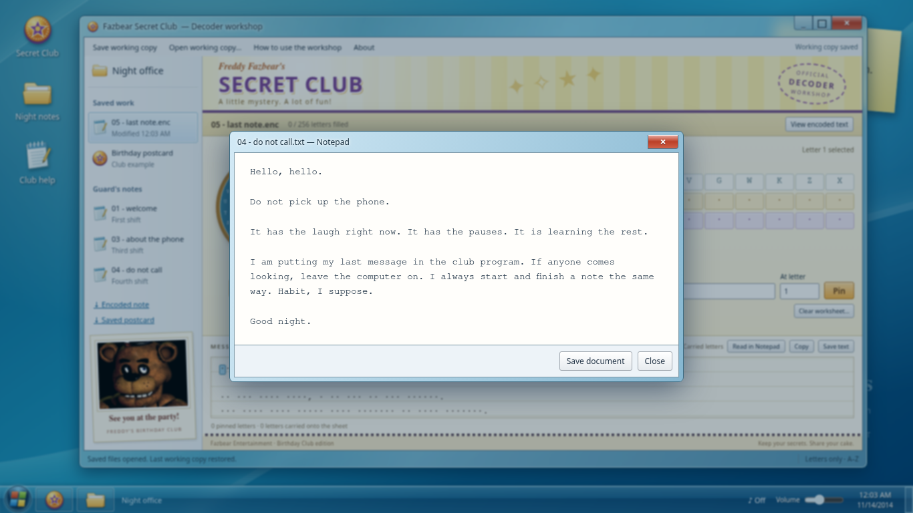
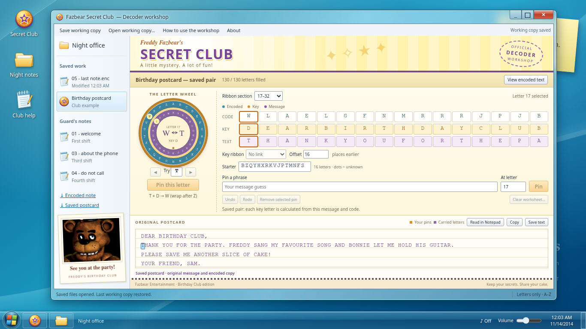
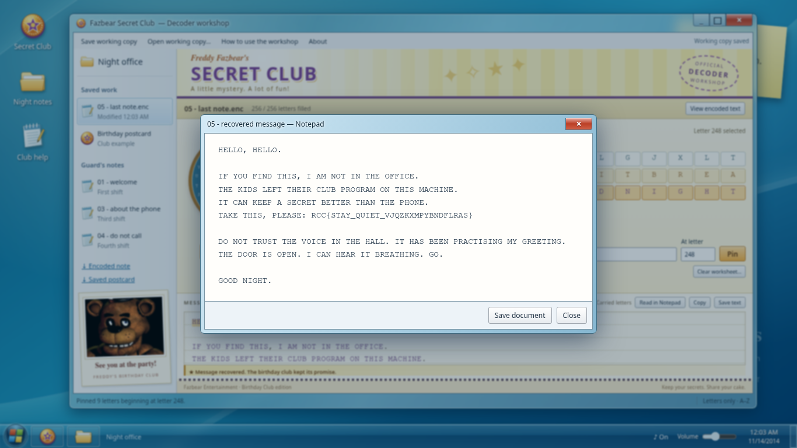

# Hello? Hello?

## Description

The last night guard left the office computer running. His notes get shorter as the week goes on. By Friday, even the telephone has become something he is afraid of.

One last message is still on the machine. Find out what he was trying to leave behind.

## Files

Run the fixed workstation from `challenge/`:

```sh
docker compose up --build -d
```

Open `http://localhost:18113`. Stop it with `docker compose down` from the same directory. The application keeps player guesses in that browser; **Clear worksheet…** resets the working note without changing the evidence. Only `challenge/public/` is served; a small private completion check validates the recovered flag. No player account is required. Sound begins on the first interaction; mute and volume are on the taskbar and remember their settings. Balloon Boy occasionally says “Hello” while the page is visible and sound is enabled.

The file browser offers `05-last-note.enc.txt` and `birthday-postcard.txt`. The three guard notes can also be opened and saved from Notepad. External cipher tools and scripts are valid alternatives to the workshop.

## Hint(s)

None.

## Walkthrough

The program uses a plaintext autokey cipher: sixteen starting key letters are followed by the message itself. A guessed message letter can reveal letters both earlier and later in the note. The guard's habitual greeting and sign-off provide enough information to recover his entire last message.

1. Read the three files under **Guard's notes**. Each begins “Hello, hello” and ends “Good night.” The third-shift note describes a sixteen-letter starter and says the postcard uses a different one. The fourth-shift note explains that the guard keeps the same opening and closing.

   

2. Open **Birthday postcard**. It is a saved plaintext/ciphertext pair. The **Code**, **Key**, and **Text** rows show corresponding letters. With A=0 through Z=25, subtracting the message letter from its encoded letter gives the key letter, wrapping around the alphabet. For example, if a message D becomes E, the key is B: 4−3=1.

3. Change **Ribbon section** to **17–32**. These key letters repeat the message letters from positions 1–16. Further sections continue the same relationship. The first sixteen key letters are a starter; afterward, the message supplies the key. The postcard's starter is not the guard's starter. In the target worksheet, set **Key ribbon** to **Copy message**, with **Offset** `16`, to express the relationship you found. The initial **No link** setting calculates only individual pinned letters.

   

4. Open **05 - last note.enc**. In **Pin a phrase**, enter `HELLOHELLO`, set **At letter** to `1`, and choose **Pin**. Spaces and punctuation do not count as letters. The workshop fills 160 of 256 letters by following the ten connected chains. Gold cells identify guesses; purple letters are calculated from them.

5. There are 256 letters in the note. Its nine-letter `GOODNIGHT` closing begins at letter 248. Enter `GOODNIGHT` in **Pin a phrase**, set **At letter** to `248`, and choose **Pin**. The closing fills the remaining chains and agrees with the greeting wherever they overlap. Incorrect pins produce a disagreement message; **Undo** removes the last change.

6. Read the recovered **Message sheet**, or choose **Read in Notepad** for a larger view. **Copy** and **Save text** preserve the actual decoded memo. A filled sheet only means all letters have values. When the real recovered flag is verified, the status changes to **Message recovered** and the children cheer “Yay!” if sound is enabled. The note remains readable and downloadable with sound muted.

   

For an external solve, number only A–Z characters. After the starter, encoded letter `i` is message letter `i` plus message letter `i−16`, modulo 26. Once either message letter is known, subtract it from the encoded letter to find the other. Carry the opening forward and the closing backward in steps of 16. This recovers the same note without the interface. Other justified plaintext guesses are also valid.

## Flag

`RCC{STAY_QUIET_VJQZKXMPYBNDFLRAS}`
