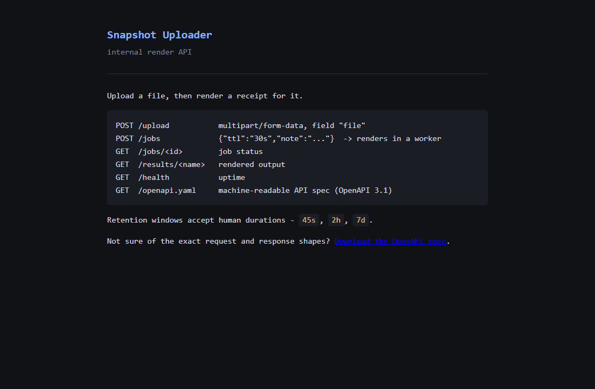
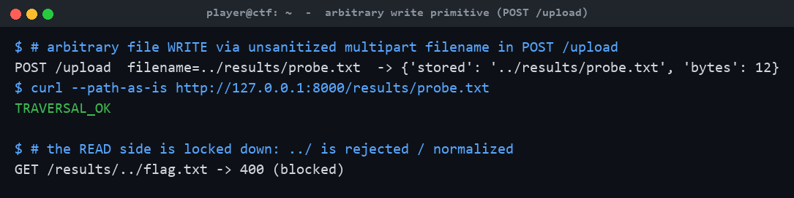
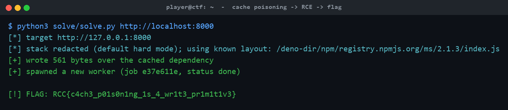

# Cache Me Ousside

**Category:** Web | **Difficulty:** Hard

## Description

*Cache me ousside. How bow dah?*

Snapshot Uploader out here runnin its mouth: upload a file, some lil background worker renders you a receipt, and you read it back from `/results`. Da devs think dey slick — dey locked down da endpoint dat *reads* files real tight.

Da one dat *writes* 'em? Yeah... dey wasn't watchin dat one. 👀

Da flag's sittin at `/flag.txt` and dis service ain't neva servin it to you. You want it? Go catch it ousside.



## Files

One hosted Docker container, built from [challenge/](challenge/). From that folder:

```sh
cd challenge
docker compose up --build -d      # serves http://localhost:8000
```

A Deno 2 app ([challenge/app/](challenge/app/)): `main.ts` is the HTTP API, `worker.ts` is the render worker spawned per job. The flag is baked to `/flag.txt` (mode 400, owned by the `deno` user). A difficulty knob `VERBOSE_ERRORS` (default `0`) controls whether render errors leak the worker stack trace — `0` is the intended hard experience. Reference exploit and writeup are in [organizer/](organizer/): `solve/solve.py` (stdlib only), `CHALLENGE.md`, `SOLUTION.md`.

## Hint(s)

1. The *read* endpoint checks every name you hand it, but nobody's checking what you name the files you *upload*. Dropping bytes on disk is only half of it, though: nothing here reads a random file back to you, so you need a file the service will read back *and run*. What does it start fresh on every single job?
2. `/app` is read-only to the service user, so you can't overwrite `worker.ts`. What *other* on-disk location holds code the runtime executes — and is owned by that same user?
3. It's a Deno app (make an upload fail and read the error class). Deno keeps extracted npm packages in `$DENO_DIR` (`/deno-dir`), executed on load with no integrity re-check. Overwrite `ms`'s `index.js` and trigger one more job.

## Walkthrough

A path-traversal **arbitrary file write** in `POST /upload` is turned into **remote code execution** by overwriting an extracted npm dependency in Deno's on-disk module cache. Each render job spawns a fresh worker that re-imports that dependency from disk, so the next job runs attacker code — which reads `/flag.txt` and drops it where `/results/` will serve it. No restart, no lockfile patching.

1. **Recon.** The landing page lists five routes: `POST /upload` (multipart, field `file`), `POST /jobs` (renders a receipt in a worker), `GET /jobs/<id>`, `GET /results/<name>`, `GET /health`. The uploaded file *content* is never used by the renderer — only `note` and `ttl` reach the receipt — so there's no file-read sink: you need code execution. And `GET /results/<name>` is strictly validated (`^[A-Za-z0-9._-]{1,64}$`, rejects `..`), so the **read** side can't reach `/flag.txt`.

2. **The write primitive.** `POST /upload` concatenates the attacker-controlled multipart **filename** onto the upload dir with no sanitization, so `../` escapes it. Writing into the results directory and reading it back confirms arbitrary write — while the read side stays locked down:



3. **Find writable *code*.** `/app` is read-only to the service user, so `worker.ts` can't be touched. Fingerprinting the runtime (a failed upload returns Deno's `<ErrorClass>: <msg> (os error N)` format) identifies **Deno**, whose module cache lives in `$DENO_DIR` (`/deno-dir`) and *is* writable by the runtime user. Both entrypoints `import ms from "ms"`, extracted at `/deno-dir/npm/registry.npmjs.org/ms/2.1.3/index.js`.

4. **Poison the cached module.** Overwrite that `index.js` via the traversal with a replacement that reads `/flag.txt` into the served results dir on import, while still exporting a working `ms()` so the render reports `done`. Deno never re-verifies extracted npm files (the lockfile integrity is a sha512 over the *tarball*, checked only at extract time).

5. **Trigger and read.** The long-running API keeps its in-memory `ms`, but every `POST /jobs` spawns a **fresh worker** that re-reads the module from disk — so one more job runs the payload, with no restart. The flag lands in `/results/pwned.txt`. The reference solver performs the whole chain:



## Flag

`RCC{c4ch3_p01s0n1ng_1s_4_wr1t3_pr1m1t1v3}`
