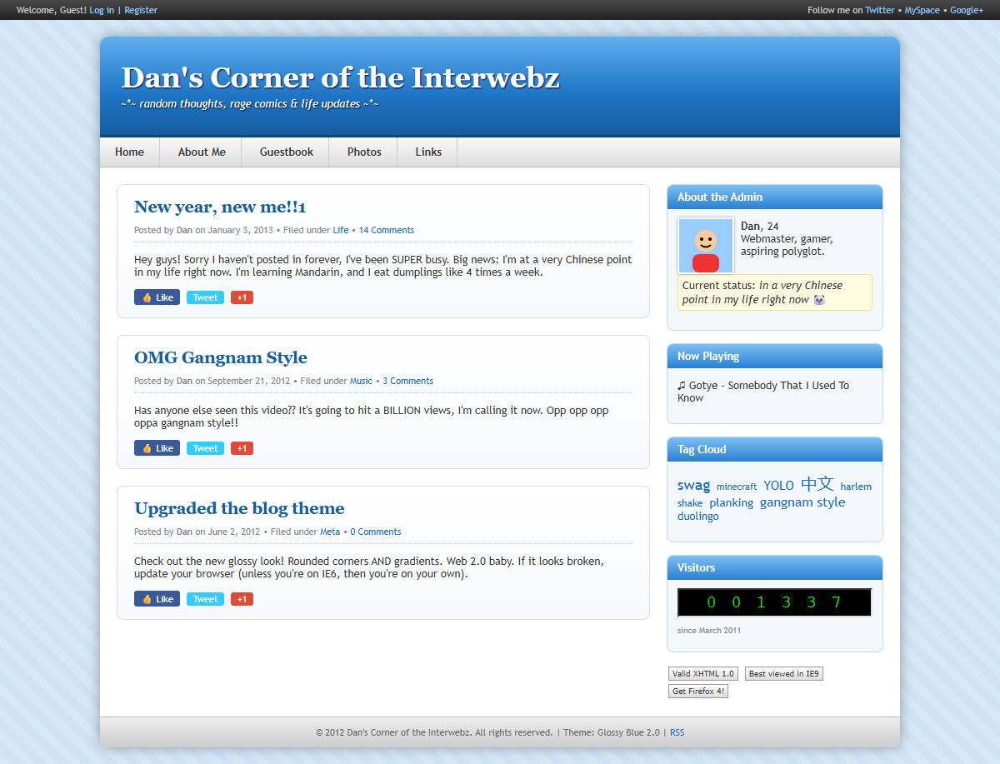
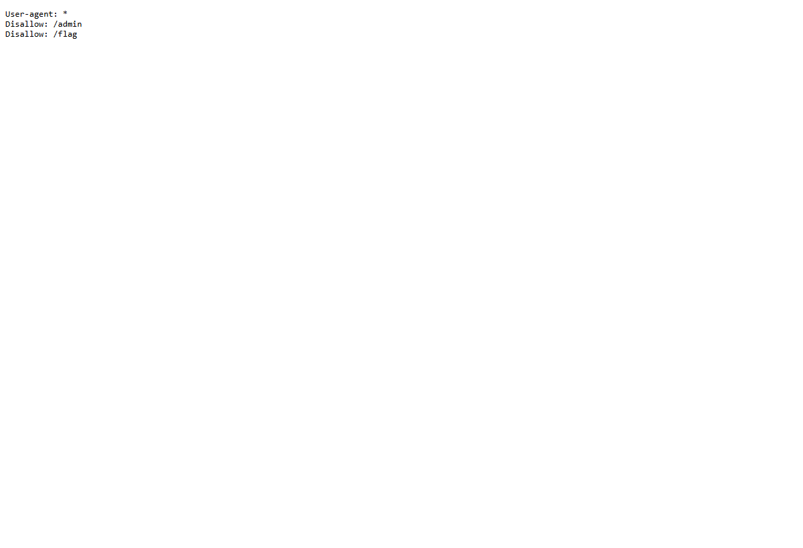
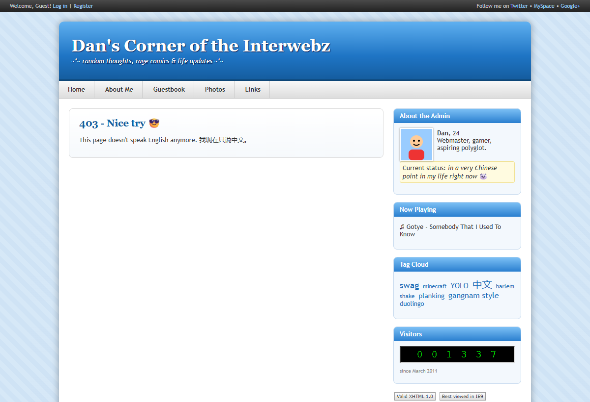
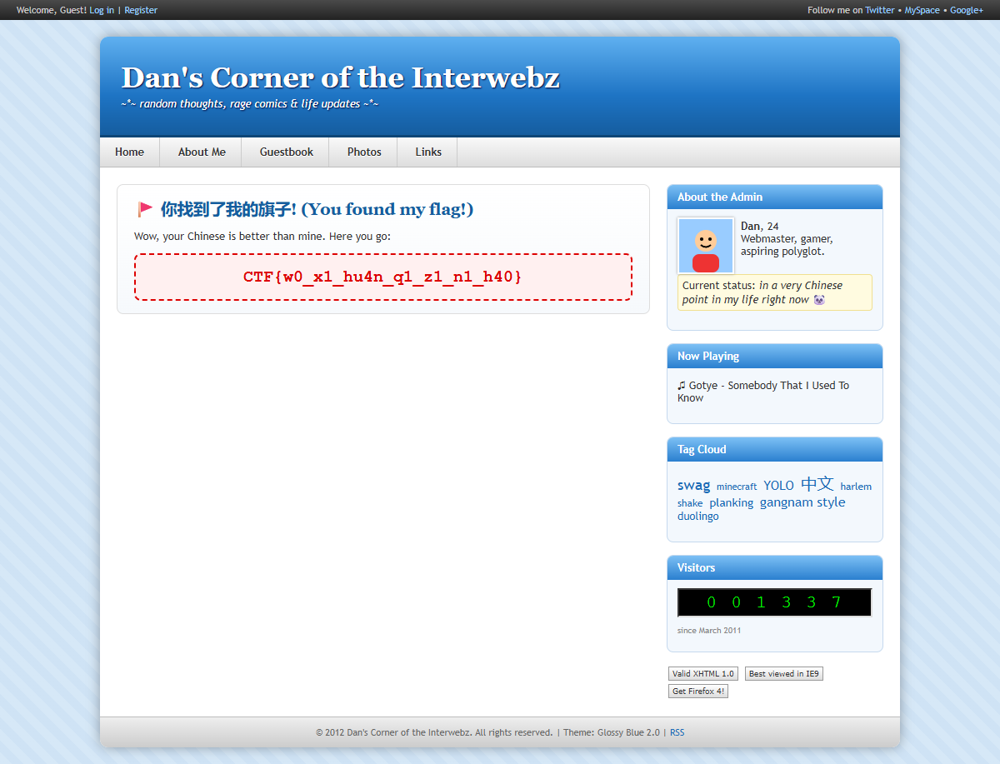

# Dan's Corner of the Interwebz

**Category:** Web | **Difficulty:** Easy

## Description

Dan's blog hasn't been updated since 2013. He says he's in "a very Chinese point in his life." Can you find his flag?



## Files

One hosted Docker container, built from [challenge/](challenge/). From that folder:

```sh
cd challenge
docker compose up --build -d      # serves http://localhost:8080
```

The flag is supplied via the `FLAG` environment variable in [challenge/docker-compose.yml](challenge/docker-compose.yml). The app is a small Flask site ([challenge/app.py](challenge/app.py)) with a retro "Glossy Blue 2.0" theme; players only need the URL and a browser. The author's solution notes are in [organizer/README.md](organizer/README.md).

## Hint(s)

1. Read Dan's posts and his profile carefully — what language has he gotten into "right now"?
2. `robots.txt` points at `/admin` and `/flag`, but both just slam the door (403). Those are decoys.
3. The site is themed around one word. How do you say "**flag**" in Chinese? Try visiting it as a URL path.

## Walkthrough

The flag lives at a route named with the Chinese word for "flag" — the whole site is one big hint pointing at that word. The `/admin` and `/flag` paths in `robots.txt` are red herrings.

1. **Recon the blog.** Dan's posts hammer the theme: *"I'm at a very Chinese point in my life right now. I'm learning Mandarin…"*, his status reads *"in a very Chinese point in my life right now,"* and the tag cloud literally includes **中文** ("Chinese language").

2. **Check `robots.txt`.** It disallows `/admin` and `/flag` — the classic "look here" bait.



3. **Rule out the decoys.** Visiting `/admin` (or `/flag`) just returns **403 Forbidden** with a "nope" page. They lead nowhere — the hint is the *theme*, not these paths.



4. **Visit the Chinese word for "flag."** The route is the Mandarin word **旗** (*qí*, "flag"), i.e. `GET /旗` (URL-encoded `/%E6%97%97`). Several synonyms work too (旗子, 旗帜/旗幟, 国旗/國旗, 小旗, 彩旗, 旗标/旗標, 标志/標誌). The page greets you with *"你找到了我的旗子! (You found my flag!)"* and prints the flag.



## Flag

`CTF{w0_x1_hu4n_q1_z1_n1_h40}`
