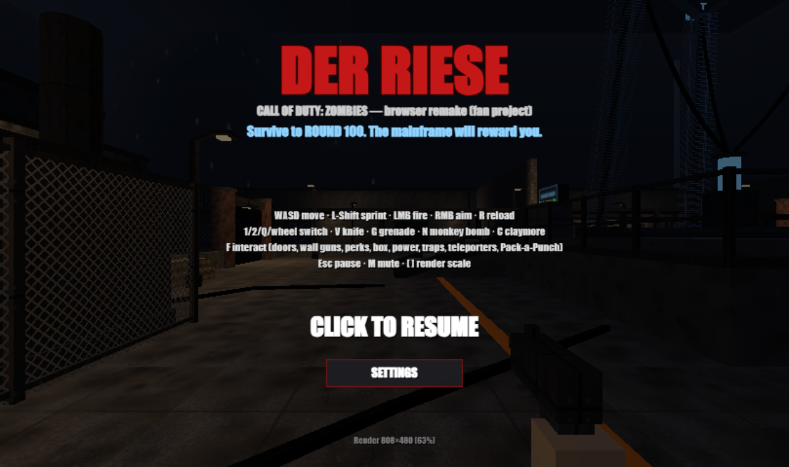
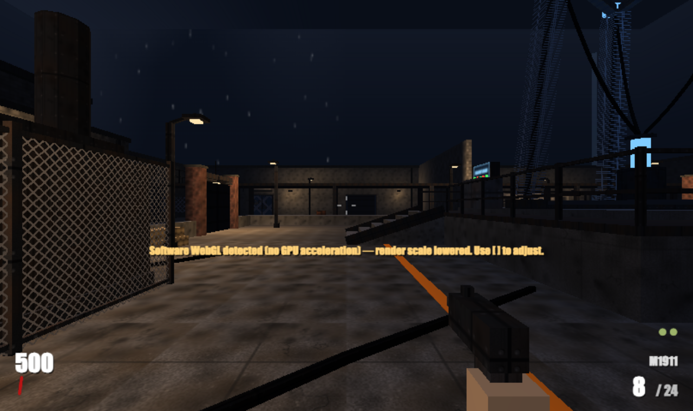
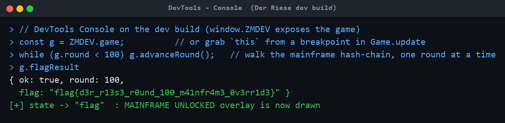
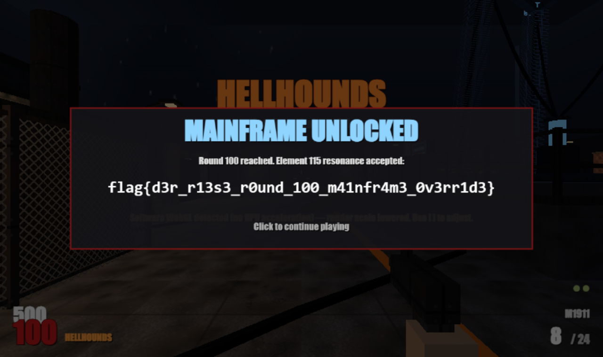
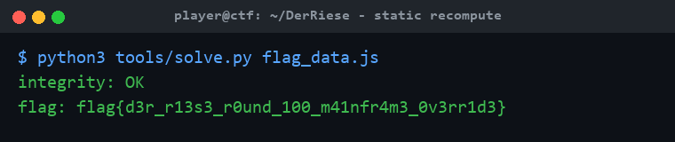

# Der Riese — Zombies

**Category:** Rev | **Difficulty:** Hard

## Description

A complete, playable first-person *Call of Duty: Zombies*–style survival game on a faithful recreation of the Der Riese layout, written from scratch in plain JavaScript (raw WebGL + Canvas2D + WebAudio) — no build tools, no dependencies, no network calls.

The mainframe will reward you at **round 100**. But the flag key is derived from a hash chain that is advanced **only** by the real round-advance code path, so you can't just set `round = 100` — a naive jump produces garbage and the mainframe rejects it. Survive to round 100… or make the game think you did, legitimately.



## Files

Players get the deployable bundle in [challenge/](challenge/) — two static files (`game.js` + `index.html`), served by any static web server:

```sh
python3 -m http.server -d challenge 8000      # then open http://localhost:8000
```

The game needs only a browser; it works over plain HTTP anywhere. Organizer material is in [organizer/](organizer/): the dev page `index.html` (loads the individual `js/` sources and exposes `window.ZMDEV` for testing; not shipped to players), the un-bundled sources in `organizer/js/` (notably `organizer/js/05_vault.js`, the flag vault), `organizer/tools/` (`gen_flag.py`, `build.py`, `solve.py`), and the encrypted flag in `organizer/flag_data.js`.

The vault design (in `organizer/js/05_vault.js`):

```
state  = sha256("DER_RIESE::MAINFRAME::115")
on every legitimate round advance r (r = 2..100):  state = sha256(state + ":" + r)
key    = sha256(state_at_round_100 + ":FLAG")
flag   = ciphertext XOR sha256-keystream   (accepted only if sha256(flag) == tag)
```

## Hint(s)

1. `game.round = 100` doesn't work — the screen says *MAINFRAME REJECTS DATA*. What is the only function that moves the round forward, and what does it do besides change the number?
2. The flag key comes from a SHA-256 chain that must be stepped once per round, 2→100. You don't have to *play* all 100 rounds — you just have to call the real round-advance that many times.
3. `Game.advanceRound()` (in `90_game.js`) is the only caller of `vault.advance()`. Drive it 99 times from round 1, or statically replay the chain yourself and decrypt `ZM.FLAG`.

## Walkthrough

Two intended routes reach the same flag: an **in-browser hack** that walks the real chain, or a **static recompute** of the chain offline. Both are shown.

1. **Recon.** Open the game and play a round. The flag is promised at round 100; the HUD tracks the round, points, and your weapon. In `game.js`, the vault (`ZM.Vault`) and `Game.advanceRound()` show that each round advance steps a SHA-256 chain, and `game.round = 100` only changes a display number — it never walks the chain, so the vault won't verify.



2. **The bug / intended route A — in-browser.** The round counter is cosmetic, but the chain state is real. Reach round 100 by calling the *genuine* round-advance repeatedly. On the dev build `window.ZMDEV.game` hands you the game object directly; against the shipped `challenge/game.js` (wrapped in an IIFE, no globals) you grab `this` from a breakpoint inside `Game.update` in DevTools → Sources, then run the loop in the Console:



3. **Collect the flag.** After the loop reaches round 100, `unlockMainframe()` opens the vault, the game state flips to the flag overlay, and the real flag is rendered on screen:



4. **Intended route B — static recompute.** You never have to touch the browser: the ciphertext and tag live in `organizer/flag_data.js` (and in the `challenge/game.js` bundle). Replay the SHA-256 round chain 2→100 exactly as the game does, derive the key, XOR-decrypt, and the integrity tag confirms the result. The reference solver does this with the standard library:



Both routes yield the identical, integrity-checked flag.

## Flag

`flag{d3r_r13s3_r0und_100_m41nfr4m3_0v3rr1d3}`
