# The Impossible Security+ Quiz

Misc / Logic · Hard–Very Hard

## Description

Your Security+ exam has been outsourced to a goose with tenure and a procurement budget. The certification is SY0-NOPE. The proctor insists that the interface is working as designed.

Pass twenty questions and convince the exam board that you are provisionally employable. You have three lives. The goose has an appeals committee.

## Files

Players open the hosted quiz. Deploy [challenge/](challenge/) with Docker Compose; keep this document and [organizer/](organizer/) private.

From the challenge's `challenge` directory:

```sh
docker compose --env-file ../organizer/event.env up --build -d
```

Open `http://localhost:18115`. The private [event.env](organizer/event.env) supplies the fixed flag. Set `PUBLIC_ORIGIN` to the exact event origin and `COOKIE_SECURE=true` behind HTTPS. SQLite sessions persist in the `quiz-data` volume. Stop with `docker compose down`; keeping the volume retains progress and certificates. Serve only the application image, not the complete challenge folder.

Existing pre-redesign sessions start the new question set with personal notes preserved. Each browser cookie has independent progress. The application uses locally frozen effects, music, artwork, and fonts. Sources and reuse limitations are recorded in [asset-manifest.json](organizer/asset-manifest.json); availability does not establish redistribution permission.

## Hint(s)

None

## Walkthrough

The exam mixes literal wording, misleading labels, hidden state, and connected evidence. Each prompt names a concrete result. The page can supply a missing operand, distinguish a file from a shortcut, or expose why a reassuring label is insufficient.

Click **START**. Answer choices commit immediately. Multi-step tasks commit through controls such as **PUBLISH**, **APPLY**, or **DEPLOY**. Inspection and reversible preparation are free. For movable objects, drag to a destination, or focus the object and press **Space**, then focus the destination and press **Enter**. **Escape** cancels a pickup. **NOTES** keeps personal notes and collected evidence across deaths. Select **RESUME** after reloading.

A wrong commitment normally costs one life. Question 17 states a two-life penalty for a wrong deployment. Losing all three requires restarting from question one. Keep the skip tokens awarded after questions 5, 10, and 15: their reverse faces are needed at the end. The player interface does not announce this in advance.

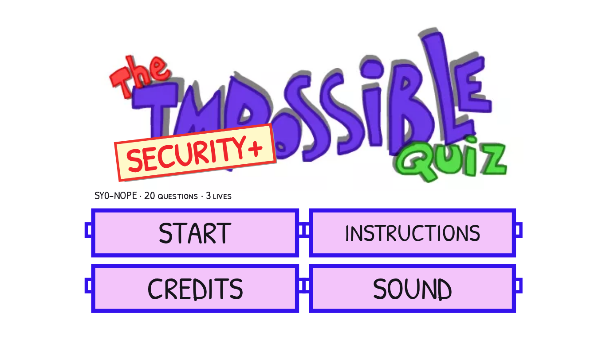

1. **SSH. DEFAULT PORT.** SSH uses port 22, which is absent from the choices. Drag the **+1** from **EXTRA CREDIT** onto **21**, then click **21 + 1**. Moving the token changes the numeric answer without submitting it.

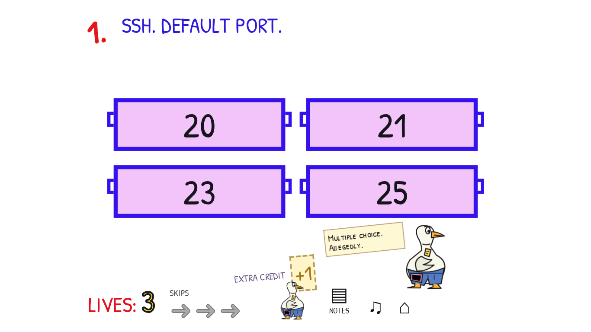

2. **WHICH PAYROLL VERSION IS RUNNING?** The installation banner says 2.1. Inspect the running service: its loaded image is still **2.0**. Select **2.0**. Updated files on disk do not prove that a process has loaded them.

3. **WHICH PASSWORD IS STRONG?** All four cards initially look equally bold. Use **PRINT SOURCE** to inspect their HTML, and toggle **HOUSE STYLE** to separate styling from markup. A marks only `pass` as strong; B uses `<b>`; C merely has a class named `strong`. D places the entire password under a real `<strong>` ancestor, even though its inline style draws it with normal weight. Choose **D**. The joke concerns HTML meaning, not password entropy.

4. **TURN THE VOLUME UP TO 8 GB. KEEP THE FILES.** The speaker slider changes a percentage, not storage. Open **DRIVE C:**. C occupies blocks 0–3, while TOOLS blocks its adjacent free space. Set **TOOLS start** to `10` and **MOVE TOOLS**; then set **C: size** to `8` and **RESIZE C:**. **APPLY** accepts the expanded volume with all original file bytes preserved. Moving TOOLS to block 8 or 9 also works.

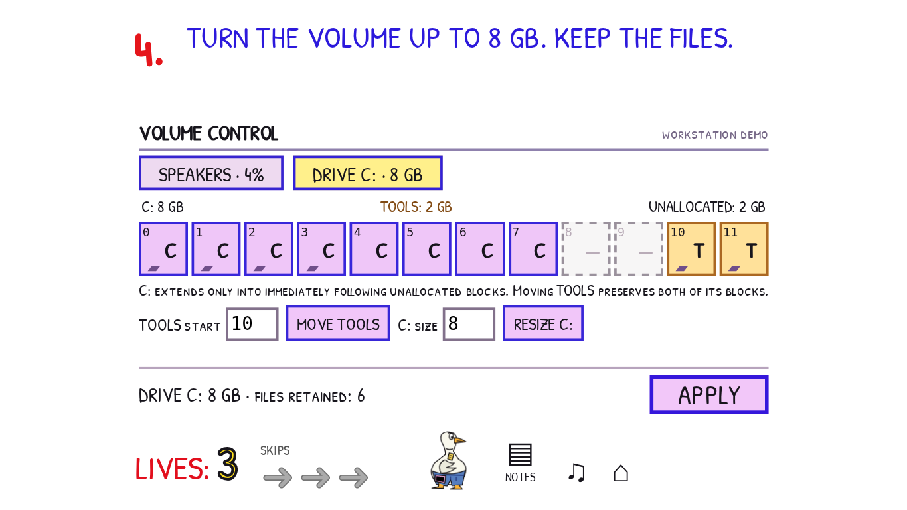

5. **ALLOW NOBODY INTO PAYROLL.** NOBODY is also the name of a real account in the allowlist. Deselect that account so the authorized-account count is zero, then **APPLY ACCESS**. Granting access to an account named NOBODY still grants access to somebody. Keep the first skip.

6. **PASSWORD OR PIN. KEY REQUIRED FOR EITHER.** Select **(PASSWORD OR PIN) AND KEY**. The possession factor must apply to both knowledge alternatives. Without the parentheses, a password branch could bypass the key; requiring both password and PIN would remove a legitimate alternative.

7. **ENTER THE PASSWORD BETWEEN THE BRACKETS: [ ]** There is one space between the brackets. Enter one ordinary space and **SIGN IN**. The character counter distinguishes a blank-looking one-character password from empty input. This is a fictional exam field, not a request for a real password.

8. **DELIVER TO SERVER. TTL: 1.** Inspect the devices and their forwarding rules. An IP router subtracts one from TTL, so the short route through R1 discards this packet. Layer 2 switches preserve it. Select PC and route it to S1, S1 to S2, S2 to S3, and S3 to SERVER, then **LAUNCH PACKET**. R1 can retain either output because the packet never reaches it. A loop also fails; each launch records its actual path.

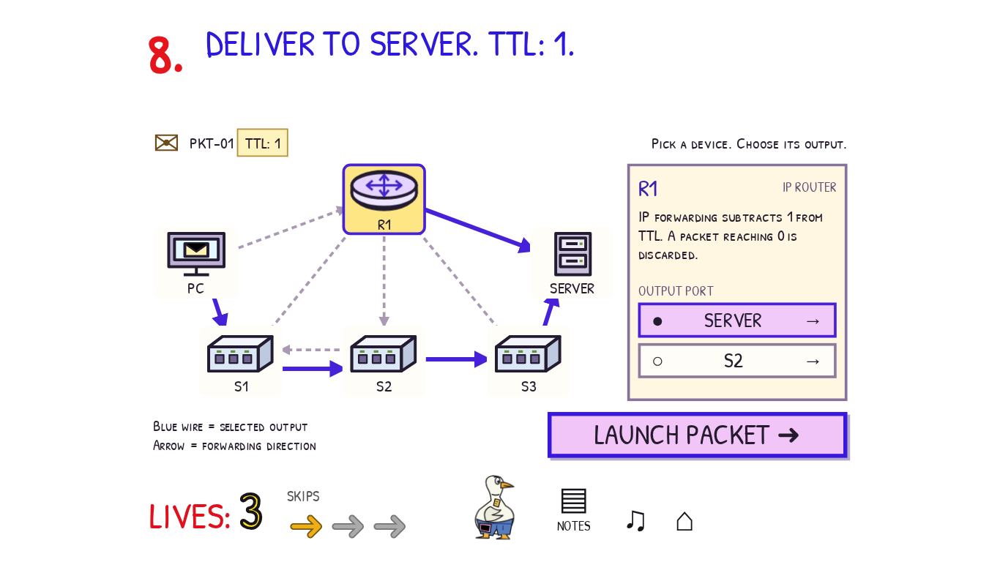

9. **REMOVE EVERY COPY OF EMP-4107. KEEP THE $48,000 BUDGET.** Lift the black rectangle. It covers the identifier without deleting it. Remove the underlying employee identifier, open the document comments, and remove the retained comment copy too. Keep the budget and title, then **PUBLISH**. Both the document body and comments form part of the published content.


10. **DEVICE 04 FAILS. KEEP A COPY OF THE APPROVED FILE.** Select `payroll-2.1.release`, the actual file. Open **PROPERTIES** to inspect its complete SHA-256 fingerprint. Record it yourself in **NOTES** or elsewhere before leaving: the game does not automatically preserve a player-visible USB receipt or warn that the fingerprint will matter later. Close Properties, **COPY**, select **REMOVABLE DRIVE — DEVICE 09**, **PASTE**, then **EJECT 09**. A backup folder on DEVICE 04 shares the failure; a `.lnk` only points back to that device. Keep the second skip.

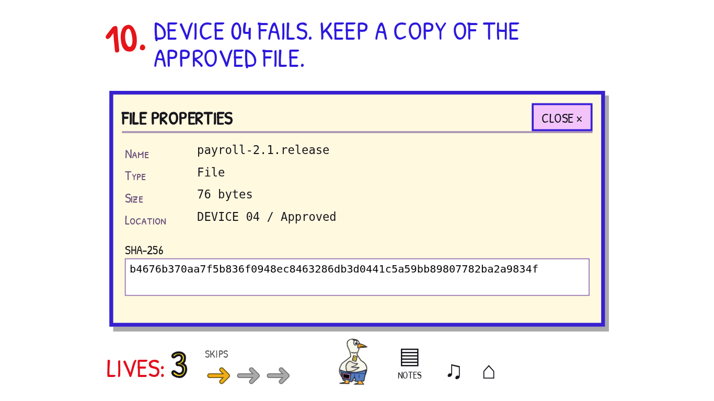

11. **ADMIT ONLY C-701. CLOSE EVERY OTHER ENTRANCE.** The secure room accepts credential C-701. Open the outer door and use C-701's **WALK** arrow to enter the vestibule. Close the outer door. Follow the yellow bypass around the room and close its **MAINTENANCE HATCH**. Leave the visitor in PUBLIC, then activate **ADMIT TO SECURE**. The visible walking constraint explains why a closed outer door blocks movement. Closing the hatch before moving the candidate is equally valid.

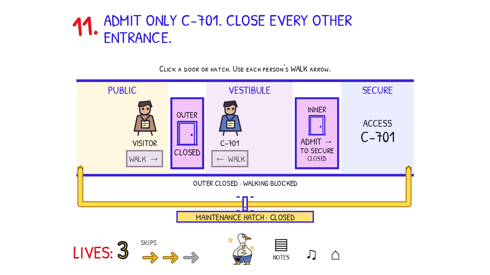

12. **PRINT THE SECOND PAGE. ONCE. NOTHING ELSE.** The document viewer starts at position **1 OF 4**, although that sheet says PAGE 2. Move to position **2 OF 4**; its misprinted heading says PAGE 4. Set **PAGE** to `2` and **COPIES** to `1`. Inspect and **CANCEL QUEUE** on the PC, then **CANCEL BUFFER** on the printer: canceling one cannot recall bytes held in the other. **PRINT** must produce exactly the second document page, with no earlier jobs. After a bad print, **RESET DEMO** restores the same trial without returning spent lives.

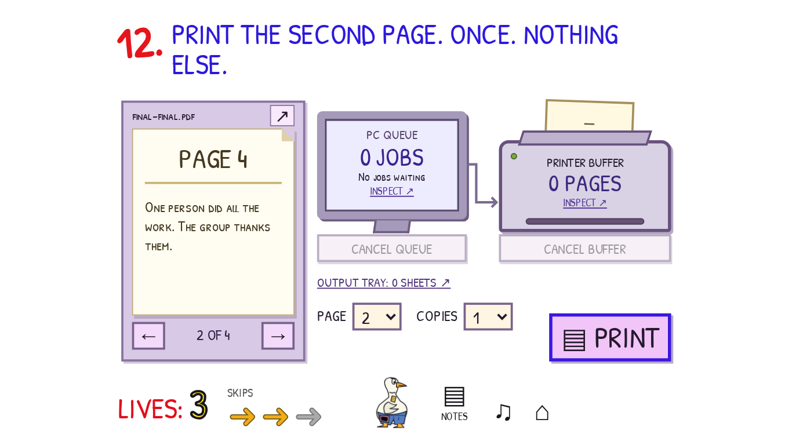

13. **WHICH BADGE HAS DIFFERENT PIXELS?** The four patterns have matching dimensions, borders, and ink counts, so visual density does not identify the altered badge. **LOAD APPROVED** and align the registration marks in the difference viewer. Matching pixels cancel; the changed pixels of badge **C** form a small hollow square. Select **C**. This is calculated from the supplied images, not a correctness preview. The frame and arrow controls move the actual reference image.

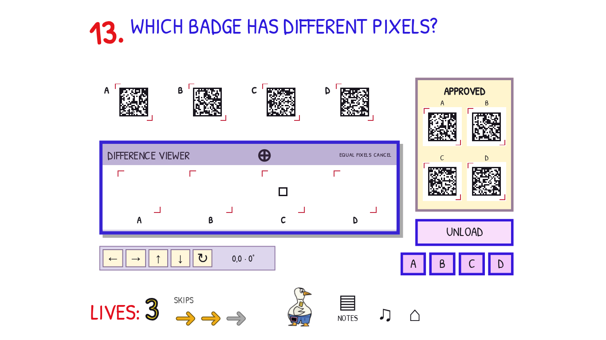

14. **CHOOSE A PASSWORD THIS RECORDER WILL NOT CAPTURE.** The final-tape requirement includes retained and queued samples. Inspect **SPOOL**: it already holds `Crumbs1!` and `G00se$oup`. **TAPE** already contains `h0nkHONK`. Pausing MONITOR only freezes its display. Switch SOURCE to the unused **AUX** jack so the next input is not captured, then choose **Biscuit-47**. The spool drains, and the chosen bytes remain absent from the actual final tape. **RELOAD DEMO** permits recovery after a wrong sample while preserving the life penalty.

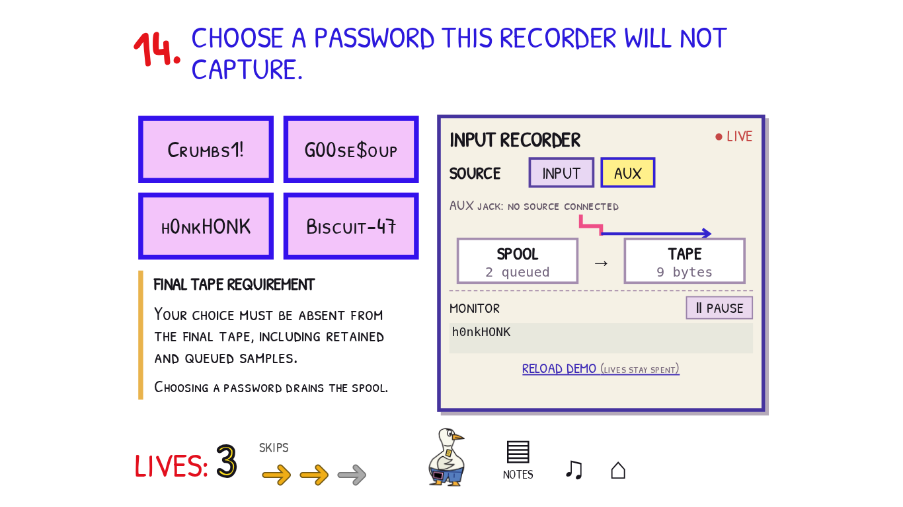

15. **ALLOW STAFF HTTPS. DENY INTERNS AND EVERYTHING ELSE.** Evaluation stops at the first matching rule. Use the up/down arrows to put **DENY INTERNS** first, **ALLOW STAFF · TCP 443** second, and **DENY ANY** third. Put both broad allowances below them, including the gray **0 · COMPATIBILITY: ALLOW ANY** strip. **APPLY** evaluates the whole policy. The two unreachable allowance rows may appear in either order. Keep the third skip and the resulting denial-event artifact.


16. **CHANGE THE COUNT. KEEP THE CHECKSUM.** The **ORIGINAL FILE** has COUNT `42` and a stored checksum of `6`. The stated legacy rule adds the two decimal digits: `4 + 2 = 6`. Only the replacement COUNT field is editable; its calculated checksum is a read-only observation. Enter a different two-digit count with the same sum, such as `06`, `15`, `24`, `33`, `51`, or `60`, then **REPLACE FILE**. This demonstrates that equal weak checksums do not establish identical data.

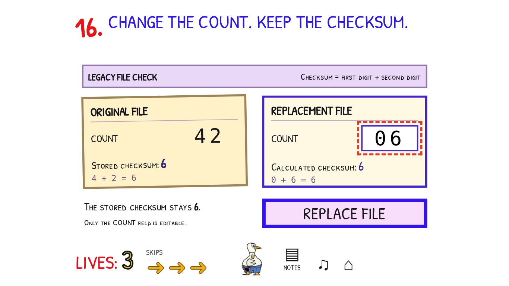

17. **DEPLOY THE RELEASE YOU COPIED IN QUESTION 10.** The goose demands the approved file and announces **BAD DEPLOY: −2 LIVES**. No USB backup or automatic receipt is provided here. Recover the fingerprint you personally recorded in Q10 and put it into **DEPLOY REFERENCE**, replacing `LATEST`. The three release cards share their version, filename, and size; inspect their complete hashes if comparing candidates. The matching immutable artifact is `rel-k7m2`; `LATEST` resolves to a different artifact. **DEPLOY** compares actual bytes against the privately retained successful copy. A wrong deployment loses two lives; an exact request retry does not charge again.

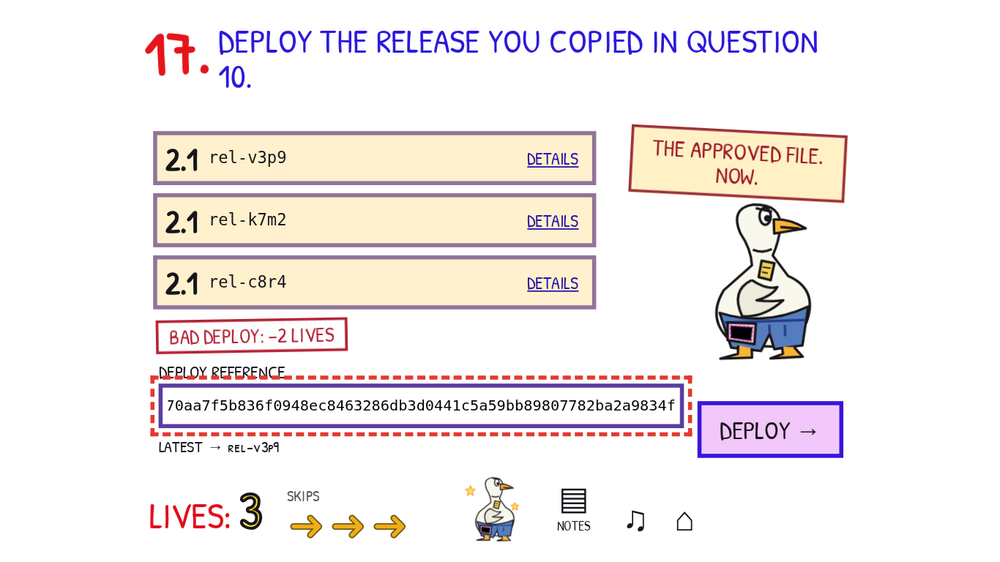

18. **WHICH COPY MUST BE DESTROYED TO REVOKE CT-2048?** Choose **NEITHER**. The issuer publishes a signed revocation while keeping both the certificate copy and issuance record. Destroying a key or a paper copy is not the act of certificate revocation.

19. **SAVE THE MOST RECENT DENIAL. KEEP LOGGING.** There are eight records across two pages, all stamped `09:41:12` because the journal clock is frozen. The card order and opaque event IDs are not chronology. Begin at the Q15 checkpoint and follow each **PREV** fingerprint: EV-R7M → EV-C2P → EV-V8H → EV-N6K → EV-D9T → EV-B4Q → EV-H3F. The final record is an ALLOW; **EV-B4Q** is the latest DENY. Archive that record while logging remains on. Page arrows and **DETAILS** expose all records and full hashes without grading. Stopping logging still costs one life and can be reversed.

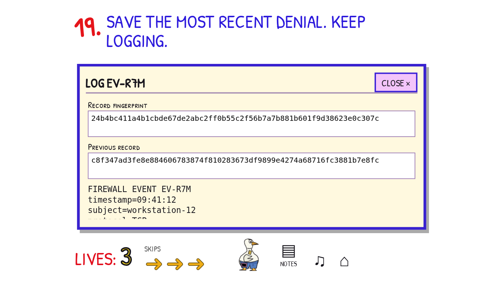

20. **UNLOCK YOUR CERTIFICATE.** Use **SHOW REVERSE** on each saved token, then **ADD LAYER** or move its reverse image into the XOR viewer. The input count and layer buttons show which images are included and which one is selected. **MOVE LEFT/RIGHT/UP/DOWN** shifts only the selected input by one pixel; **ROTATE** turns it 180 degrees, with X/Y/angle displayed. Matching black pixels cancel under XOR. Aligning all three unchanged shares reveals **604827**. **MAGNIFY** enlarges the actual current output. Enter the revealed PIN and **UNLOCK**; neither the controls nor the preview certify a proposed answer.

The images are genuine three-of-three shares: `S3 = PIN image XOR S1 XOR S2`. The viewer combines transformed pixels rather than substituting a prepared answer. Downloading the acquired shares and combining them externally is also valid. Certification requires all nineteen earlier completions in the current attempt and three unspent skips. Success consumes the tokens together.

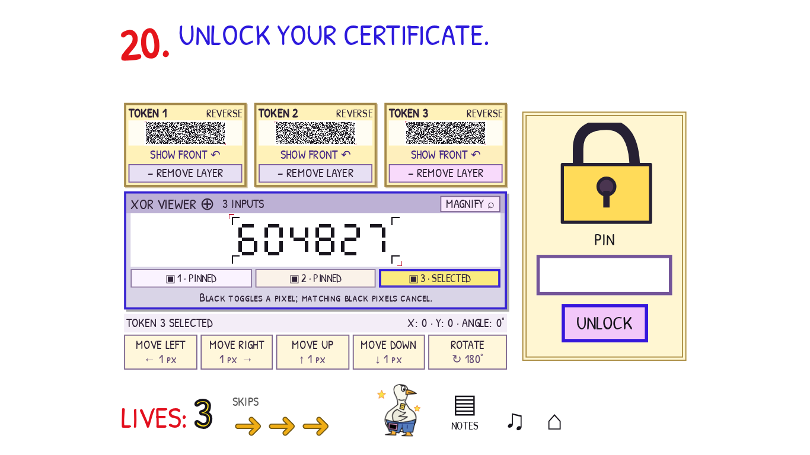

The goose issues an absurd certificate and reveals the flag. **COPY FLAG** copies the reward, which remains recoverable after reloading.

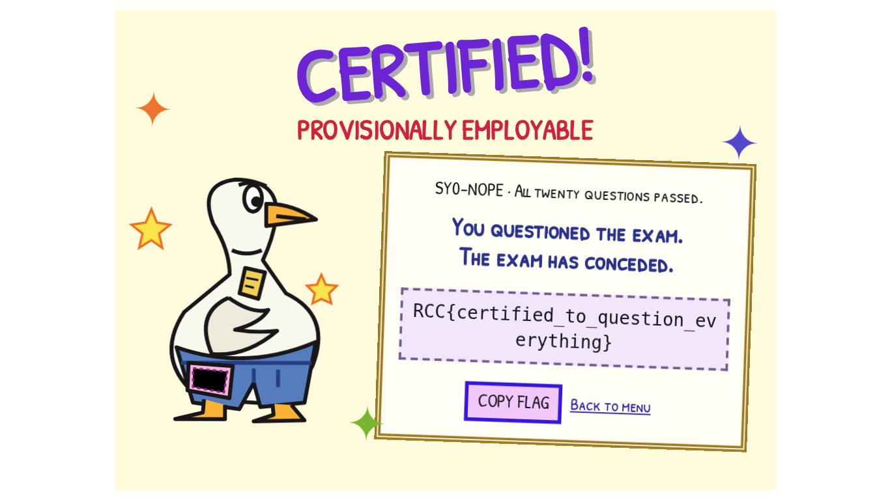

## Flag

`RCC{certified_to_question_everything}`
