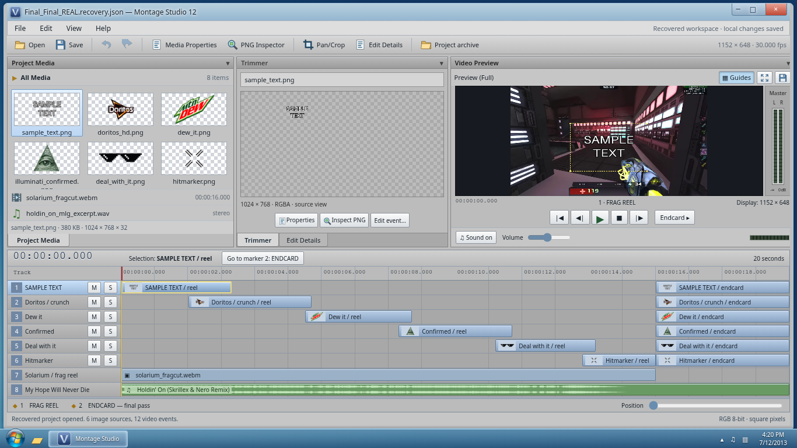
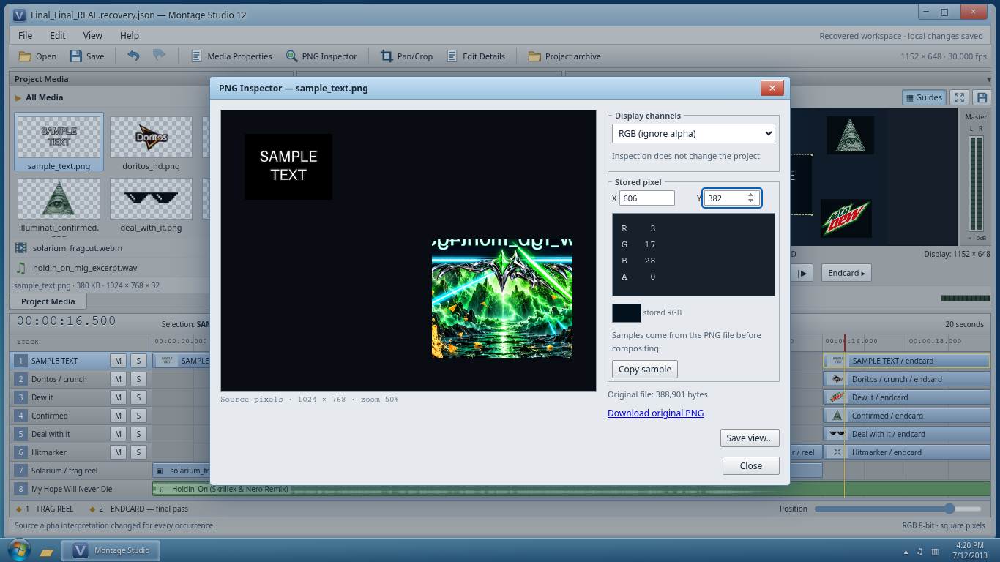
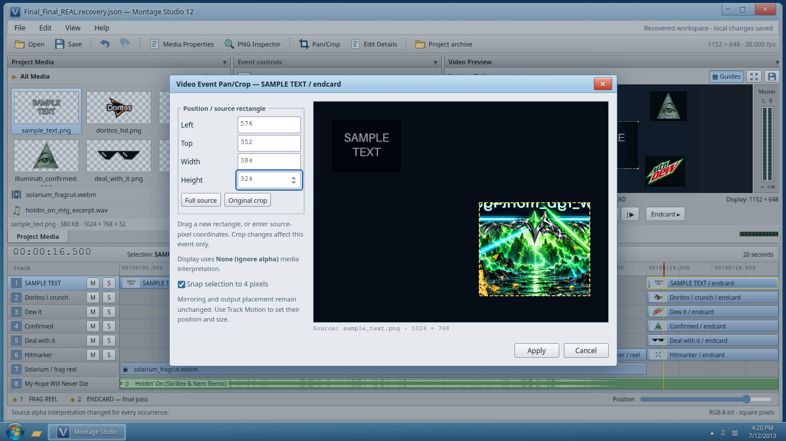
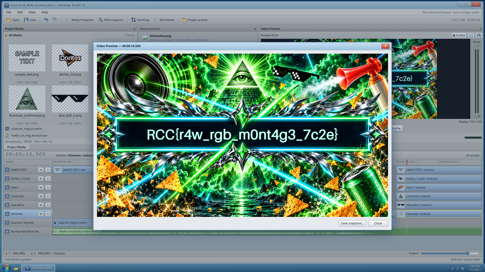

# SAMPLE TEXT: Final_Final_REAL

## Description

I've been working on my editing skills. I saw some clips on Dailymotion of these cool edits and decided to try it. But the my computer crashed! My endcard doesn't seem to have saved properly, but I know for a fact it's still there. 

Can you putthe ending back together? The endcard had a real 'wow' message.

## Files

**Category:** Steganography / Forensics  
**Difficulty:** Medium

Run the static editor from this challenge folder:

```sh
docker compose -f challenge/compose.yaml up --build -d
```

Open **http://localhost:18114** in a current desktop Chromium or Firefox browser. The application includes the project, media, PNG inspection tools and frame export. Edits stay in the current browser; **File → Save project as…** downloads a reusable recovery project.

The same player evidence is available as [recovered-project.zip](challenge/public/media/recovered-project.zip), also downloadable from **Project archive** in the editor. It contains six original PNG overlays, the recovery-project JSON, the frag reel, soundtrack, format reference and media credits. This is a recovery interchange file, not a native Vegas `.veg` project. The editor serves only `challenge/public/`.

## Hint(s)

None.

## Walkthrough

The pictures contain more information than their ordinary previews show. Each PNG has an invisible region whose RGB channels hold a piece of an illustrated endcard. Reveal those color channels, then repair each endcard event's crop, orientation and placement. The artwork's continuous outlines and interrupted lettering show how the pieces join.

1. Play the frag reel, then use **Endcard ▸** to reach the last four seconds. Select a picture in **Project Media**. The small meme image occupies only a fraction of its listed **1024 × 768** source size. **Media Properties** also shows that the same file supplies both an earlier montage event and an endcard event.

   

2. Open **PNG Inspector**. Move over the apparently empty margins. Some stored pixels have changing red, green and blue values even though **A = 0**. Alpha controls visibility; zero alpha does not require the stored RGB channels to be zero. Choose **RGB (ignore alpha)**. A piece of a detailed illustration appears in the margin. Inspection alone does not change the project.

   

3. Close the inspector. Choose **Edit Details** to show the event controls. Change **Alpha channel** to **None (ignore alpha)** in the event controls or **Media Properties**. The source now displays its stored RGB, but the timeline still shows the old meme crop. This is the source/event distinction: changing media interpretation does not remove an event's crop or mirroring.

4. Open **Pan/Crop…** for the selected endcard event. Drag the crop rectangle over the illustrated fragment, or enter its source coordinates. The fragment boundaries are visible against the plain surrounding pixels. Use **Apply**, then **Use crop size** under **Track Motion** to display the recovered piece at its original dimensions.

   

5. Repeat for the six endcard events. Each fragment is **384 × 324**. Mirror pieces where necessary, using the artwork's orientation and matching edges. Drag them in **Video Preview**, or enter **Left** and **Top** under **Track Motion**. Some earlier montage mirroring is inappropriate for the ending. The continuous cyan frame, chrome ornaments, speaker, pyramid and soda can identify neighboring pieces. All flag lettering crosses the middle seam, so the upper and lower fragments need to meet.

   The completed arrangement is:

   | Source | Crop Left, Top | Mirror X | Mirror Y | Output Left, Top |
   |---|---|---|---|---|
   | `doritos_hd.png` | 352, 400 | Off | On | 0, 0 |
   | `deal_with_it.png` | 384, 368 | Off | Off | 384, 0 |
   | `illuminati_confirmed.png` | 608, 384 | Off | On | 768, 0 |
   | `hitmarker.png` | 512, 416 | On | Off | 0, 324 |
   | `sample_text.png` | 576, 352 | On | Off | 384, 324 |
   | `dew_it.png` | 448, 320 | On | Off | 768, 324 |

   Set **Width = 384** and **Height = 324** for both the crop and output placement of every piece. Keep the six endcard events visible and clear **Solo**.

6. Turn **Guides** off and open the larger **Video Preview**. The endcard's central line contains the actual flag. **Save snapshot…** exports the current composition as a real PNG; it does not replace the frame with a prepared answer. Save the recovery project to keep the edits as well.

   

The external route uses the same evidence. Extract the archive and inspect a PNG with Pillow, which retains the independent RGBA samples:

```python
from PIL import Image

image = Image.open("media/sample_text.png").convert("RGBA")
print(image.getpixel((606, 382)))  # Nonzero RGB, alpha 0
image.putalpha(255)
image.save("sample_text-rgb.png")
```

Repeat for the other sources. Crop the visible illustrated rectangles and arrange them in an image editor using the same visual joins. For example, the SAMPLE TEXT fragment is `image.crop((576, 352, 960, 676))`; flip it horizontally, then place it at `(384, 324)` in a **1152 × 648** image. The table above describes the remaining pieces. The distributed format reference explains source coordinates and output coordinates for anyone recreating the composition in a script.

## Flag

`RCC{r4w_rgb_m0nt4g3_7c2e}`
