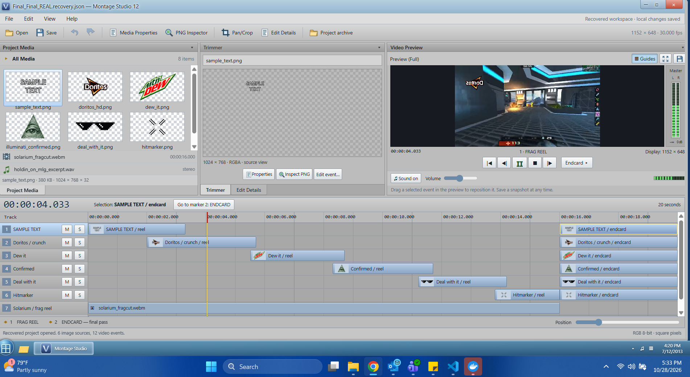
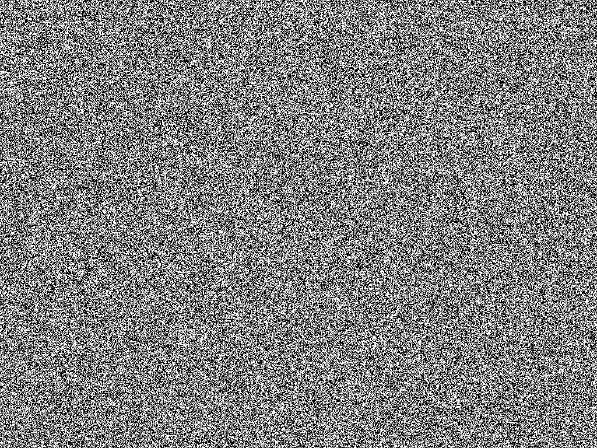
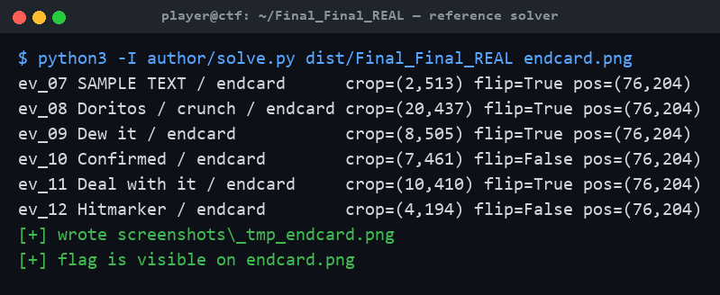
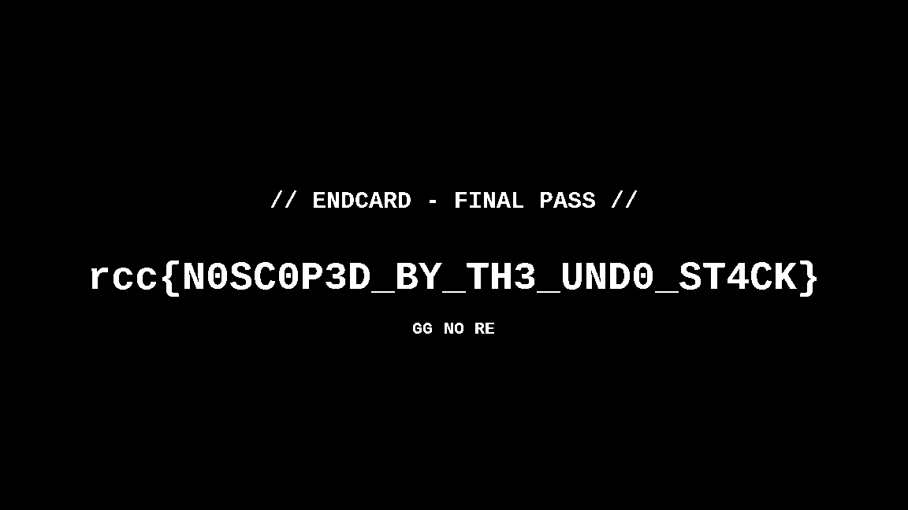

# Final_Final_REAL

**Category:** Forensics | **Difficulty:** Medium

## Description

July 12, 2013. xX_Qu1ckSc0p3r_Xx was *this close* to finishing the sickest Solarium frag montage of all time. The ENDCARD had all six overlays lined up perfectly for the final pass. Then Montage Studio 12 crashed mid-save.

All that came back is the recovery file and the media folder. He swears the endcard "had the flag on it" and that he "lined it up pixel perfect, then messed with it a bunch, then hit Ctrl+Z until it looked right again."

Rebuild the final pass.

## Files

Players download a single handout, **`Final_Final_REAL.zip`** (in [challenge/](challenge/)). No server — this is a static forensics challenge. The archive contains:

- `Final_Final_REAL.recovery.json` — the crashed project's recovery file: the saved project state plus a journal of every edit/undo/redo the author performed.
- `media/` — the six overlay PNGs (`doritos_hd.png`, `dew_it.png`, `illuminati_confirmed.png`, `deal_with_it.png`, `hitmarker.png`, `sample_text.png`) plus a `.webm` frag clip and a `.wav` track (the last two are optional flavor hints only).

Reference material for organizers lives in [organizer/](organizer/): `solve.py` (reference solver), `generate.py` (rebuilds the whole challenge), `expected_endcard.png`, `flag.txt`, the unzipped handout `Final_Final_REAL/` (so the solver can be run directly), and the challenge metadata `challenge.yml`.

## Hint(s)

1. Look at the PNGs one bit plane at a time. Then look at what blend mode the endcard events use.
2. The `saved_state` is stale. Every number you need for the endcard comes out of replaying the journal, and Ctrl+Z / Ctrl+Y mean what they mean in every editor.
3. Each PNG alone is pure noise. Crop → flip → place each endcard layer on the 1152×648 canvas and XOR all six together. If you see static, your replay is wrong.

## Walkthrough

The data is hidden in the least-significant bit of the six overlay PNGs, and the parameters needed to line them up are recovered by correctly replaying the editor's undo/redo journal. The intended solve is below; the reference implementation is [organizer/solve.py](organizer/solve.py) (run it against the unzipped handout: `python3 organizer/solve.py organizer/Final_Final_REAL endcard.png`).

1. **Find the data.** Isolate bit 0 of a channel for any overlay PNG. On its own, every layer is uniform noise — there is no visible picture, which is the tell that the payload is split across all six layers (an XOR secret-share).

2. **Find the rule.** In `Final_Final_REAL.recovery.json`, the six `/ endcard` events carry `"blend": "difference"`, and `render_order` is `pan_crop → flip_h → place at transform.x/y → blend`. *Difference blending at a depth of 1 bit is exactly XOR.* (Frame 121 of the webm and the `L−R` channel of the wav spell this out as optional confirmation.)

3. **Recover the real parameters.** `saved_state` is **stale** — all six endcard crops there are wrong. Replay the `journal` over it with real linear undo/redo semantics:
   - `edit.apply` = one undo unit (all of its `changes` applied together), and applying a new edit **clears the redo stack**.
   - `edit.undo` reverts the top unit and pushes it onto redo.
   - `edit.redo` re-applies the top redo unit.
   - `ui.select`, `transport.*`, `preview.snapshot`, `file.save` are not undoable and are skipped.

4. **Composite.** For each of the six endcard events, take the LSB plane of its PNG, crop it to `pan_crop`, mirror it if `flip_h`, place it at `(transform.x, transform.y)` on a 1152×648 canvas, and XOR it in. Running the reference solver does exactly this:

5. **Read the flag.** Once all six correctly-replayed layers are XORed together, the endcard resolves and the flag is printed across the canvas.

> Shortcuts fail by design: using `saved_state` as-is gets 6/6 events wrong; ignoring undo/redo gets 3/6 wrong; forgetting that a new edit clears redo still gets 2/6 wrong. Because XOR shares are all-or-nothing, a single wrong layer leaves only static — there is no partial signal to hill-climb.

## Flag

`rcc{N0SC0P3D_BY_TH3_UND0_ST4CK}`
