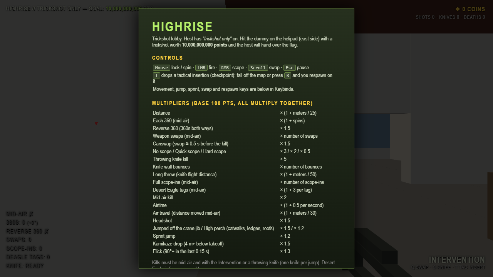
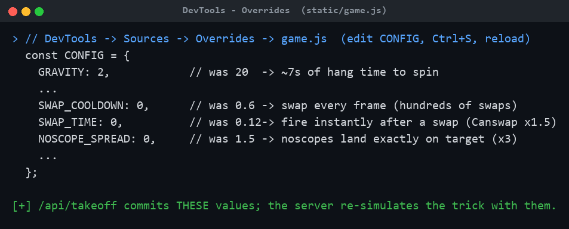
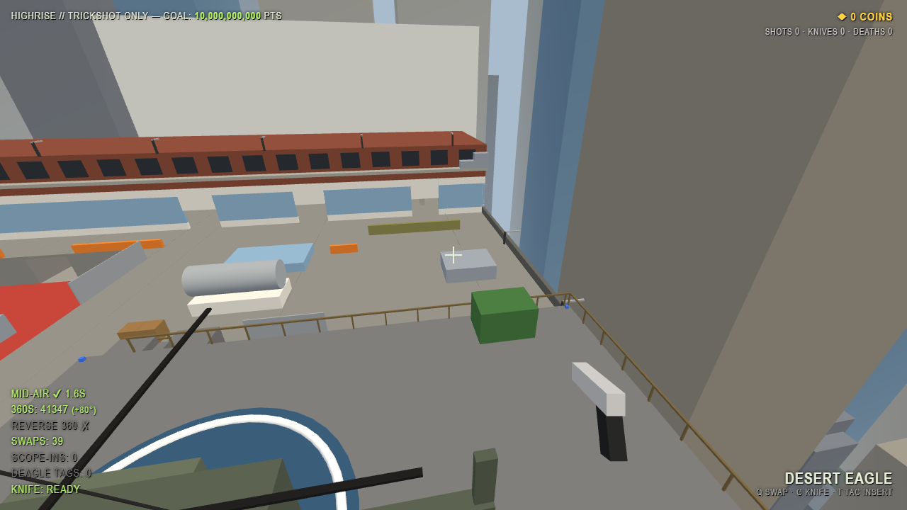
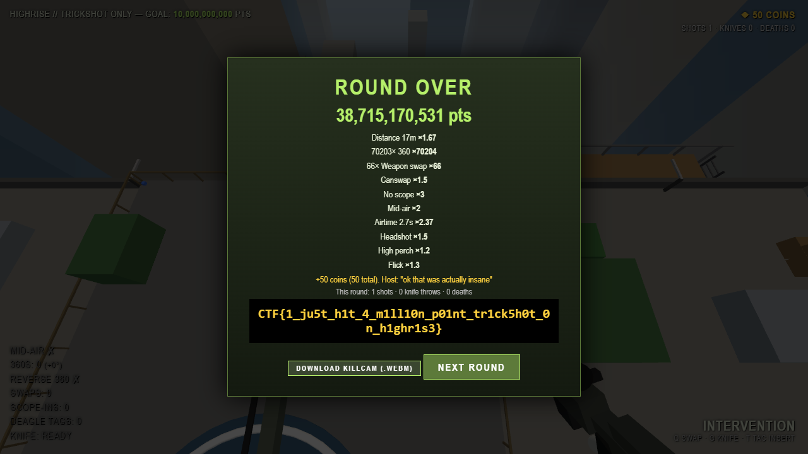

# Highrise Trickshot

**Category:** Web | **Difficulty:** Easy-Medium

## Description

Trickshot-only lobby on Highrise. The host will give you the flag if you hit a trickshot worth **10,000,000,000 points**. Good luck, MLG pro.



## Files

One hosted Docker container, built from [challenge/](challenge/). From that folder:

```sh
cd challenge
docker compose up --build -d      # serves http://localhost:8081
```

The flag is set by the `FLAG` env var (see [challenge/docker-compose.yml](challenge/docker-compose.yml)); redeem codes are configured there too. Players need only a browser. The client is [challenge/static/game.js](challenge/static/game.js) (+ `challenge/static/map.js`, `challenge/static/index.html`); the authoritative server/anti-cheat is [challenge/app.py](challenge/app.py). Author writeup: [organizer/SOLUTION.md](organizer/SOLUTION.md).

## Hint(s)

1. The client never sends a score — the server re-simulates your whole jump from a frame-by-frame input log and computes every multiplier itself. So editing the score, `REQUIRED_SCORE`, or the captured packet gets you nowhere.
2. Look at `/api/takeoff`: it sends your `CONFIG` object, and the server replays the trick with **whatever physics you committed** (within loose ranges). What happens if you change the physics before you jump?
3. The perk shop names the exact knobs: lower `GRAVITY` (more hang time → more spins), `SWAP_COOLDOWN`/`SWAP_TIME` → 0 (swap every frame), `NOSCOPE_SPREAD` → 0 (noscopes land dead-on). Edit them in `game.js` via DevTools Overrides, then actually pull off the trick.

## Walkthrough

The anti-cheat is only "as strong as the settings you commit." `/api/takeoff` trusts the client-supplied `CONFIG`, and the server re-simulates the trick with it — so editing the physics in the client changes what the server considers possible. The score grows roughly with `airtime² × spins × swaps`, and two multipliers (360s and swaps) have no cap.

1. **Recon.** Play a round and watch the Network tab: `POST /api/session` (one-time ticket + dummy spawn), `POST /api/takeoff` (your `CONFIG` + starting state, committed on jump), `POST /api/trickshot` (the frame-by-frame input log). The server replays the log, re-checks the final shot really hits its dummy, checks airtime vs wall-clock, burns the ticket, and computes the score. So replaying fails (ticket used), editing stats is impossible (none are sent), and editing the final packet can't change the already-committed settings.

2. **The bug / edit the physics.** In `game.js`, `CONFIG` holds the physics the client sends at takeoff. Edit four values via DevTools → Sources → **Overrides** (right-click `game.js` → Override content, Ctrl+S, reload) — the exact knobs the perk shop hints at:



   - `GRAVITY: 20 → 2` — seconds of hang time instead of ~0.7s, so far more spins and a bigger airtime multiplier.
   - `SWAP_COOLDOWN: 0.6 → 0` and `SWAP_TIME: 0.12 → 0` — swap weapons every frame (each adds ×0.5) and fire instantly after a swap (Canswap ×1.5).
   - `NOSCOPE_SPREAD: 1.5 → 0` — noscopes land exactly where you aim (×3).

   (`MAX_TURN_RATE` already defaults to the server cap of 1e7 °/s, so there's effectively no spin-speed limit.)

3. **Pull off the trick.** With the edits committed at takeoff, jump off the deck and — while airborne — spin as fast as the game accepts and spam weapon swaps; the HUD shows the **360s** and **Swaps** counters exploding. (The `MOMGETTHECAMERA` redeem code + the Aimbot perk make the final shot trivial.)



4. **Land the shot and collect the flag.** Before touching down, fire the Intervention (noscope) at the dummy for a mid-air headshot. The server re-simulates the committed trick, the score clears 10,000,000,000, and the host hands over the flag:



> This walkthrough was produced by driving the *real* client through its genuine input-recording path (the same automation the author used in their headless test): only the four `CONFIG` values were changed, and the server independently re-simulated the recorded spins/swaps/shot and returned the flag — a verified solve (final score **38,715,170,531**: 70,203× 360 · 66× swap · Canswap · No scope ×3 · Mid-air ×2 · Headshot · High perch · Flick).

## Flag

`CTF{1_ju5t_h1t_4_m1ll10n_p01nt_tr1ck5h0t_0n_h1ghr1s3}`
