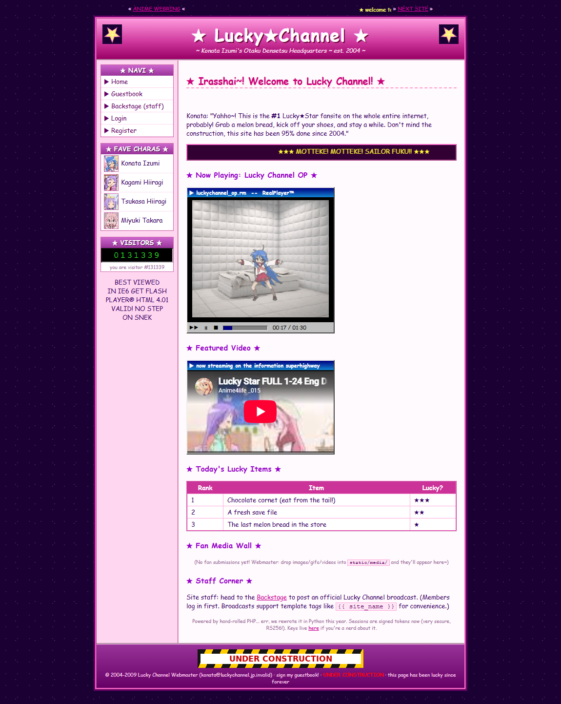
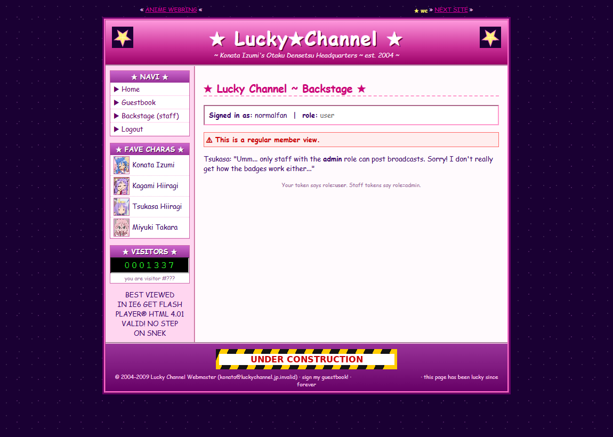
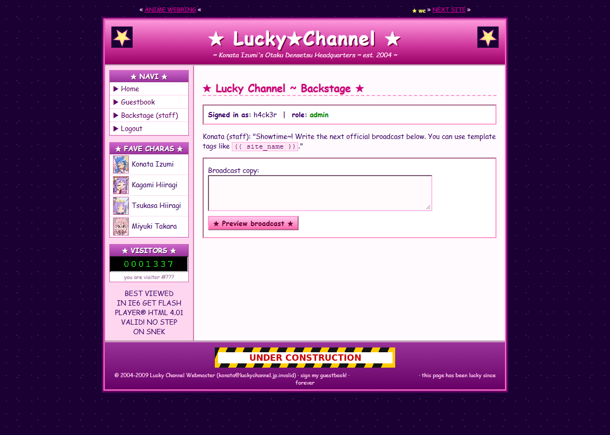
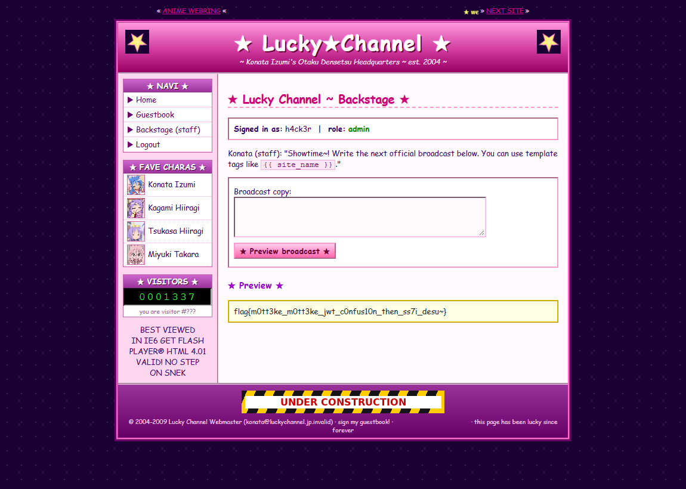
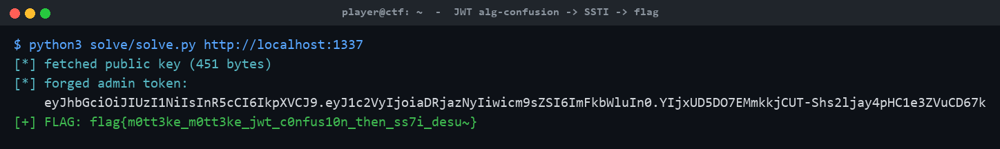

# ★ Lucky☆Channel ★

**Category:** Web | **Difficulty:** Hard

## Description

Welcome to *Konata Izumi's Otaku Densetsu HQ* — a lovingly rebuilt early-2000s anime fan portal: tiled starfield, `<marquee>`s, 88×31 buttons, a hit counter stuck at a leet number, a guestbook, a webring, and a members-only **Backstage**. The staff swear the new session tokens are "very secure, RS256!" … but the intern left something on from the 2003 build. Two bugs stand between you and `/flag.txt` — and you'll have to **chain** them.



## Files

One hosted Docker container, built from [challenge/](challenge/). From that folder:

```sh
cd challenge
docker compose up -d --build      # browse http://localhost:1337
```

Listens on **port 1337**, fully self-contained (no outbound network, no headless bot). The flag is set by the `FLAG` env var and written to `/flag.txt` at container start. Both bugs live in [challenge/app.py](challenge/app.py) (commented); the RS256 keypair is generated at build by [challenge/gen_keys.py](challenge/gen_keys.py). Reference exploit: [organizer/solve/solve.py](organizer/solve/solve.py); author writeup: [organizer/SOLVE.md](organizer/SOLVE.md).

## Hint(s)

1. The home page brags "RS256!" and links the **public key**. Every page also carries an HTML comment: *"backstage still has the old **HS** compat path turned on from the 2003 build."*
2. Stage 1 is a classic JWT **algorithm-confusion**: the legacy verifier accepts **HS256** and uses the *public key* as the HMAC secret. The public key is published, so you can mint your own `role=admin` token.
3. Stage 2: the admin broadcast preview is **Jinja2 SSTI**, but a blacklist blocks `os`, `system`, `subprocess`, `eval`, `import`, `request`, `config`, `mro`, `subclasses`, `getattr`, `self`, `lipsum`, `attr(` … It does **not** block the builtins route. Reach `open` through a Jinja global.

## Walkthrough

Forge an admin session via a JWT RS256→HS256 confusion bug, then use the admin-only template preview for Jinja2 SSTI — bypassing the keyword blacklist by reaching `builtins.open` to read `/flag.txt`.

1. **Recon.** `GET /robots.txt` disallows `/backstage` and `/lucky-channel/pubkey`. The home page says sessions are "signed tokens now (very secure, RS256!)" and links the public key; a page comment admits backstage still accepts the legacy **HS** path. Registering and logging in gives a `lucky_token` JWT with `{"role":"user"}` — and the backstage shows only a "regular member view," no broadcast box:



2. **Stage 1 — JWT algorithm confusion → admin.** Session JWTs are signed RS256, but `/backstage`'s hand-rolled legacy verifier also accepts HS256 and computes the MAC using the **public key PEM as the HMAC secret**. Fetch the published key from `/lucky-channel/pubkey`, then forge a token with header `{"alg":"HS256"}` and payload `{"role":"admin"}`, signing with `HMAC_SHA256(key=<pubkey bytes>, msg="<hdr>.<pay>")`.

3. **Become staff.** Set the forged value as the `lucky_token` cookie and reload `/backstage`. The server now sees `role=admin` and the staff **broadcast preview** box appears:



4. **Stage 2 — SSTI past the blacklist → read the flag.** The broadcast preview renders your input with `render_template_string`. The content filter blocks the usual RCE and gadget routes, but not the builtins route. Submit a payload that reaches `open` through a Jinja global:

   ```jinja
   {{ cycler.__init__.__globals__.__builtins__.open("/flag.txt").read() }}
   ```

   `cycler` is a built-in Jinja global; `.__init__.__globals__` exposes the module globals containing `__builtins__`; none of the banned substrings appear. The rendered flag comes back in the preview pane:



The reference exploit performs the whole chain automatically:



> Red herrings: the guestbook auto-escapes (no XSS); the seeded `konata:haruhi` account is a plain member (you must forge the token); and `os.popen`-style RCE payloads stay blocked even as admin — just `open()` the file.

## Flag

`flag{m0tt3ke_m0tt3ke_jwt_c0nfus10n_then_ss7i_desu~}`
