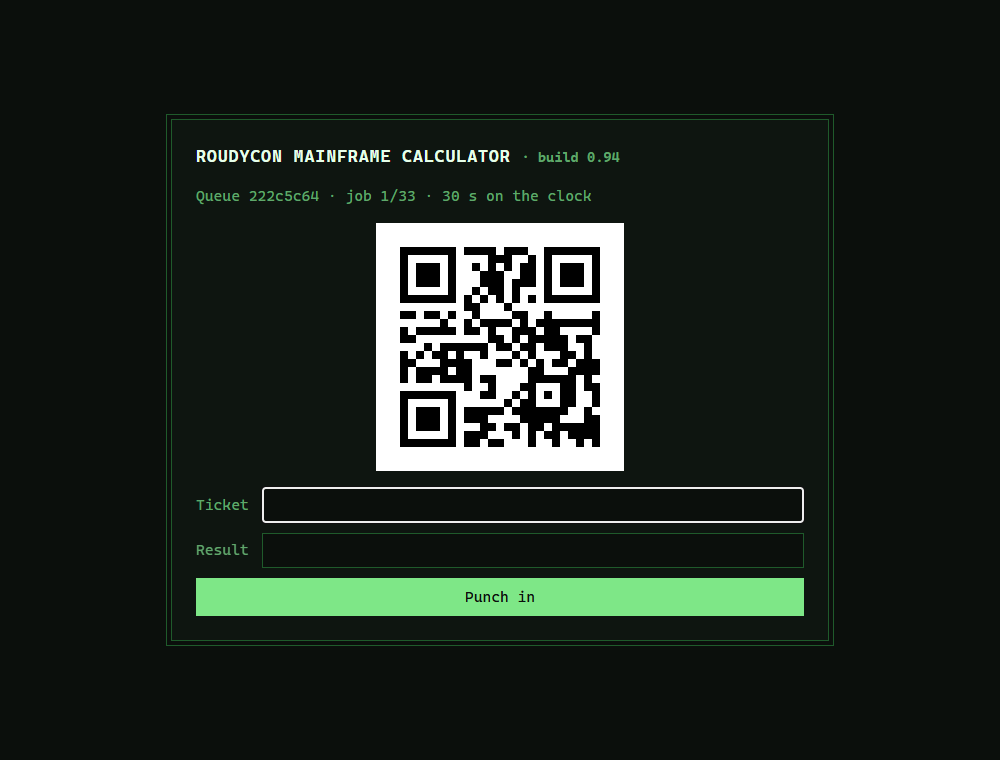
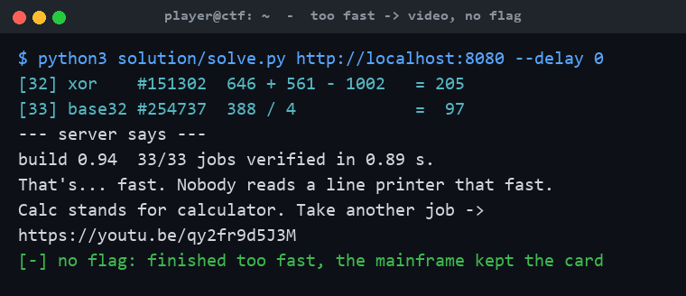
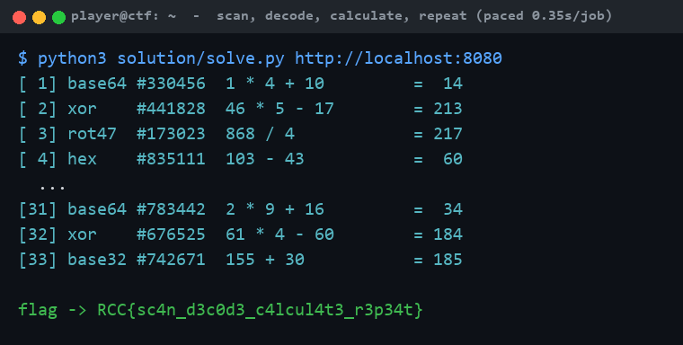

# Mainframe Calculator

**Category:** Misc (Web / Scripting) | **Difficulty:** Medium

## Description

The RoudyCon mainframe still does payroll, but its display died years ago. Jobs come off the line printer as QR codes, and the night-shift operators got into the habit of wrapping each job in *some* encoding first. Nobody remembers which. It may not even be the same one twice.

It has 33 jobs for you. It is not a patient machine. It is not a fast one either.

`http://<host>:8080/`



## Files

One hosted Docker container, built from [challenge/](challenge/). From that folder:

```sh
cd challenge
docker compose up --build -d      # serves http://localhost:8080
```

Plain HTML forms, no JavaScript — it works from `curl`, a phone, or a script. The flag and timing knobs (`FLAG`, `FIRST_TIMEOUT`, `ROUND_TIMEOUT`, `TOO_FAST`) are set in [challenge/docker-compose.yml](challenge/docker-compose.yml). The app is a stateless Flask service ([challenge/server/server.py](challenge/server/server.py)); round state rides in a signed hidden token, so there's no database. Reference solver and writeups are in [organizer/](organizer/): `solution/solve.py` (needs Pillow + a QR decoder), `README.md`, `solution.md`.

## Hint(s)

1. Round one is plain base64. After that it's a different encoding each time — try the usual suspects (base64, base32, hex, rot47, single-byte XOR) until one reads like a job.
2. Too many jobs to do by hand, but tear through them and the machine decides you cheated. Add a small pause between jobs.
3. Clear the queue at a steady pace and the mainframe just prints the flag — no final step to fight. Go too fast and it won't.

## Walkthrough

The challenge name *is* the walkthrough: **scan** a QR code, **decode** whatever the night shift wrapped it in, **calculate** the sum inside, and **repeat** — at a believable pace — until the queue runs dry.

1. **Recon.** `/` explains the setup; `/start` opens a queue and renders a job: a status line, one QR code (inline PNG), and a form posting `ticket`, `result`, and a signed hidden `token` to `/answer`. There's no session — the token carries the round number, queue id, deadlines, and a keyed commitment to the expected answer, and travels with every request.

2. **Decode the layers.** Pull the base64 PNG from the ``, decode the QR with any library. What comes back is a *job* under one more wrapper: round 1 is always base64, every round after picks one of base64 / base32 / hex / rot47 / single-byte-XOR at random. You don't have to recognize which — a real job always matches `#<digits>: <arithmetic>`, so try all five decoders (brute-forcing the 255 XOR keys) and keep the one that matches.

3. **Do the sum.** The expression is integer `+ - * /` (divisions always come out even); parse it with `ast` rather than `eval()`. Each answer is 0–255 — and is actually `flag_char XOR pad_byte`, so the values you punch in never spell anything. The `ticket` (random, only inside the QR) stops anyone brute-forcing `/answer` blindly.

4. **The pacing trap.** `POST /answer` before the deadline (30 s on job 1, 5 s after) advances to the next job. But clear the whole run in under 10 s and the operator decides nobody reads a printer that fast — you get a music video, no flag. Too slow and you miss a deadline. The window that works is ~0.3 s to 5 s per job; **~0.35 s/job** is comfortable. Firing as fast as the network allows hits the "too fast" ending:



5. **Clear the queue at pace → flag.** You never un-mask anything yourself: finish all 33 jobs at a human-ish pace and the server runs your masked answers back through the per-queue pad and prints the flag on the finish page:



## Flag

`RCC{sc4n_d3c0d3_c4lcul4t3_r3p34t}`
