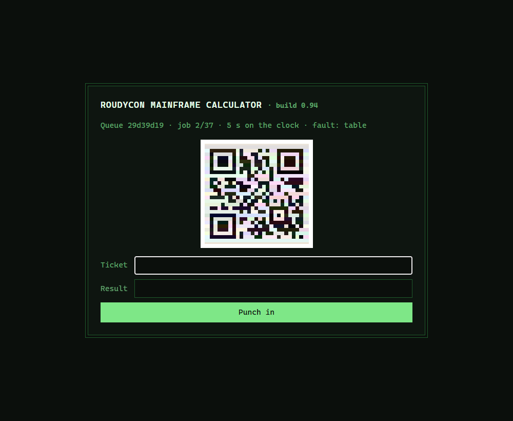
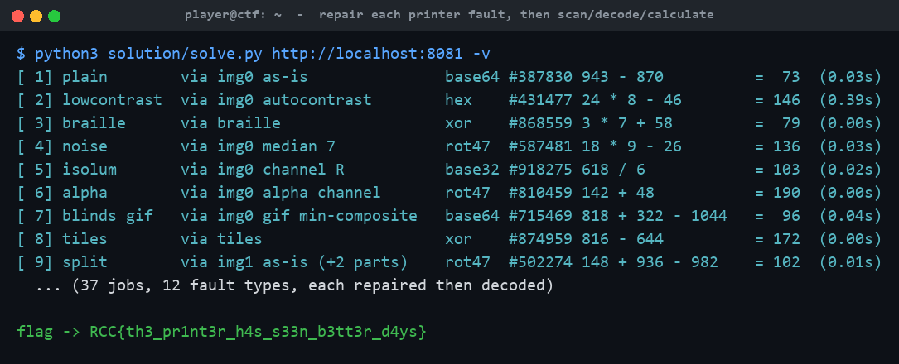

# Mainframe Calculator: Printer's Gone

**Category:** Misc (Web / Scripting) | **Difficulty:** Hard

## Description

The RoudyCon mainframe still does payroll, but its display died years ago. Jobs come off the line printer as QR codes, wrapped in whatever encoding the night shift felt like that day.

The printer has seen better days too. The paper feed slips, the ribbon is nearly dry, the colour heads drifted, the print head strobes, and when it jams the operators fall back to the embosser or just type the thing in as a table. Every job comes out wrong in its own way.

37 jobs. Your phone can probably still read them. Your script will have to work for it.

`http://<host>:8081/`



## Files

One hosted Docker container, built from [challenge/](challenge/). From that folder:

```sh
cd challenge
docker compose up --build -d      # serves http://localhost:8081
```

Same game as the easy Mainframe Calculator, with a broken line printer bolted on. The twelve faults live in [challenge/server/faults.py](challenge/server/faults.py); the base game is [challenge/server/server.py](challenge/server/server.py). Flag and timing knobs are in [challenge/docker-compose.yml](challenge/docker-compose.yml). Reference solver (Pillow + NumPy + a QR decoder) and writeups are in [organizer/](organizer/): `solution/solve.py`, `README.md`, `solution.md`.

## Hint(s)

1. It's the easy Mainframe Calculator with a busted printer. Get a plain solver working first, then teach it to repair each job.
2. The header names the fault, and the fix follows from it: pick the one clean frame, read a single colour channel, stretch the contrast, rebuild the grid from the HTML…
3. Watch for a job split across two or three codes labelled `i/n` — collect them, put them back in order, join, *then* decode.

## Walkthrough

Underneath this is the easy Mainframe Calculator (QR → mystery cipher → integer sum → paced submissions → masked answers the server un-masks for you). What's new is that from job two onward the QR arrives mangled by one of **twelve printer faults**, and you must repair it before any decoder will read it.

1. **Get the base game working.** Each job is a page with a status line, a QR (in some state), and a form posting `token`/`ticket`/`result`. Round 1 is a clean base64 QR; the payload is `#<ticket>: <expression>` under base64/base32/hex/rot47/XOR; answers are `flag_char XOR pad_byte`; finish 37 jobs at ~0.35 s/job (not under 10 s total, not past a 5 s deadline) and the server prints the flag. See the easy version's writeup for the base mechanics.

2. **Identify the fault families.** The status line names the fault, but you don't branch on it — the job regex is a perfect oracle, so you throw a pile of candidate repairs at each page and keep the first payload that cracks into a job. The twelve faults sort into four families:
   - **Hiding in a GIF** (`wavy_gif`, `blinds_gif`, `diff_gif`): try every frame, the min-composite of all frames, and the thresholded difference of consecutive frames.
   - **Hiding in a colour channel** (`isolum`, `alpha`, `lowcontrast`, `noise`, `interlace`): try the image as-is, autocontrast, the alpha channel, each R/G/B channel, a ~7 px median filter, and the de-interlace phases.
   - **Never an image** (`table`, `tiles`, `braille`): rebuild the module grid from the HTML itself — expand `<td colspan>` cells, un-rotate and reposition CSS-grid tiles, or decode Unicode braille glyphs.
   - **Split** (`split`): several QR codes prefixed `i/n|`; collect by index, sort, join, *then* crack the cipher.

3. **Run the repair pipeline.** For each job the solver generates candidate images cheapest-first, decodes each, and cracks the first payload that matches a job — so it never has to be right about which fault it's facing. Each repair runs in a few milliseconds, so the 5 s deadline is never the constraint; the deliberate ~0.35 s pause is. The reference solver (`-v`) narrates the fault, the repair that won, the encoding, and the sum for all 37 jobs:



4. **Clear the queue at pace → flag.** As in the easy version, finish all 37 jobs at a human-ish pace and the server un-masks your run and prints the flag on the finish page.

## Flag

`RCC{th3_pr1nt3r_h4s_s33n_b3tt3r_d4ys}`
