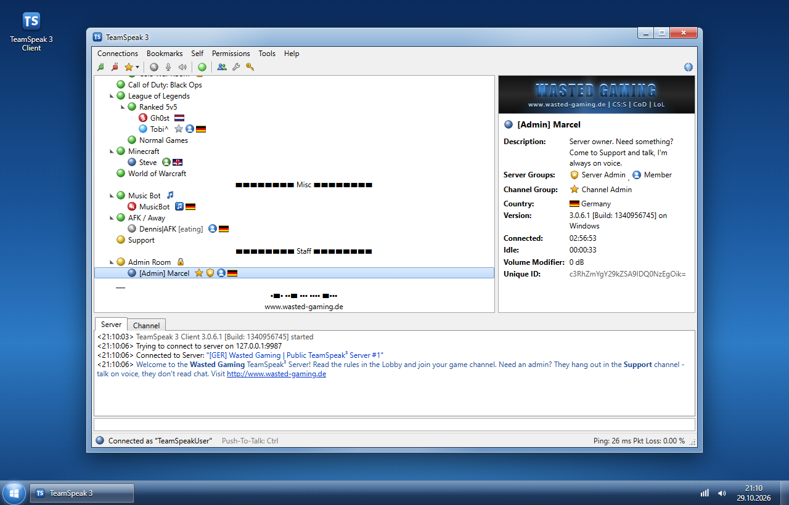
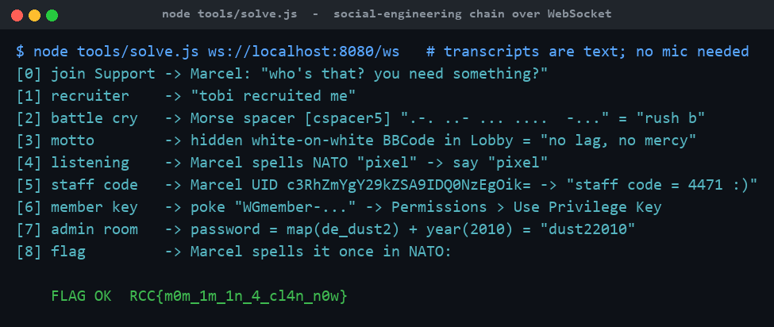

# My First Gaming Clan

**Category:** Misc (OSINT-ish) | **Difficulty:** Medium

## Description

It's 2010. You finally have a headset, and you want into a real clan.

**[GER] Wasted Gaming | Public TeamSpeak³ Server #1** is still up. The owner, **Marcel**, is online most evenings and he is the one who hands out the key to new members. He never writes anything down, he does not read chat, and he only talks to people who can prove they belong.

Connect, find him, and get yourself recruited. Everything you need is somewhere on the server.

**Requirements:** Google Chrome or Microsoft Edge with a microphone (speech recognition runs in your browser). Push-To-Talk is **Ctrl** (Options > Capture).



## Files

One hosted Docker container, built from [challenge/](challenge/). From that folder:

```sh
cd challenge
docker compose up --build -d      # serves http://localhost:8080
```

A browser clone of the 2012 TeamSpeak 3 client (Windows 7 Aero) with a Node.js backend that behaves like a TS3 server (channel tree, spacers, password channels, groups, privilege keys, pokes, kicks, scripted bots). Marcel is a deterministic state machine with fuzzy matching, not an LLM; his replies are pre-rendered Speex-flavoured voice clips. Flag and the admin-room password are set in [challenge/docker-compose.yml](challenge/docker-compose.yml). The dialogue logic is in [challenge/server/voice/](challenge/server/voice/). Reference solver and writeups are in [organizer/](organizer/): `README.md`, `writeup.md`, `description.md`. The WebSocket solver (`tools/solve.js`) is shipped inside the image.

> **Deploy note:** the microphone only works on **HTTPS** origins (or `localhost`), so behind the CTFd/instancer proxy, TLS must be terminated and WebSockets (`/ws`) proxied. This is an HTTP(S)+WebSocket challenge, so the HTTPS-subdomain proxy mode is fine.

## Hint(s)

1. Marcel vets new people like it's 2011: he asks who vouched for you. Clan members leave traces everywhere on a server like this — in channels, in profiles, in the way they decorate things.
2. A TeamSpeak unique ID is base64. So is a lot of other stuff.

## Walkthrough

Marcel only talks on voice and only *speaks* the flag; every answer he wants is hidden somewhere in the client. The intended path is a chain of small OSINT-style finds. (Speech-to-text happens in the browser and the server only receives text, so the whole chain can also be driven over the WebSocket — which is exactly what `tools/solve.js` does.)

1. **Find Marcel.** The welcome message and the Support channel description say admins only listen on voice. Join **Support**, hold **Ctrl**, and Marcel walks over to greet you. Ask for the key → *"Only clan members get that. Who recruited you?"*
2. **Who recruited you? → Tobi.** `Tobi^` (Operator in *Ranked 5v5*) has the description *"WG recruiter – poke me if you want to join."* Say *"Tobi recruited me."*
3. **Battle cry → rush b.** A decorative spacer near the bottom of the tree uses `▪`/`▬` instead of the usual bars: `▪▬▪ ▪▪▬ ▪▪▪ ▪▪▪▪  ▬▪▪▪` — **Morse code** (`.-. ..- ... ....  -...`) = "rush b."
4. **Motto → no lag, no mercy.** The Lobby rules end with a line in white-on-white BBCode (`[color=#ffffff]…[/color]`); select the description text to reveal *"no lag, no mercy."*
5. **Listening test.** Marcel spells a random word in the NATO alphabet (e.g. *pixel*); say it back. This is the warm-up for how the flag is delivered.
6. **Staff code → 4471.** Tobi (poke/PM) says Marcel *"hides it in his own unique ID."* Right-click Marcel → Copy Unique ID (also shown in his info frame): `c3RhZmYgY29kZSA9IDQ0NzEgOik=`. It looks like a real 28-char TS3 UID, but base64-decodes to `staff code = 4471 :)`.
7. **Become a member, then the Admin Room.** Marcel pokes a privilege key — redeem it via **Permissions > Use Privilege Key** — then sends you to the **Admin Room**, whose password is *"our map plus the year we started"*: the CS:S channel topic `de_dust2 24/7` → **dust2**, and server info *Created: 14.03.2010* → **2010**, giving `dust22010`.
8. **The flag.** Alone in the Admin Room, Marcel spells the flag once in the NATO alphabet (with "capital" before uppercase letters). "Repeat" works three times.

The reference WebSocket solver walks the whole chain and decodes the spoken flag:



## Flag

`RCC{m0m_1m_1n_4_cl4n_n0w}`
