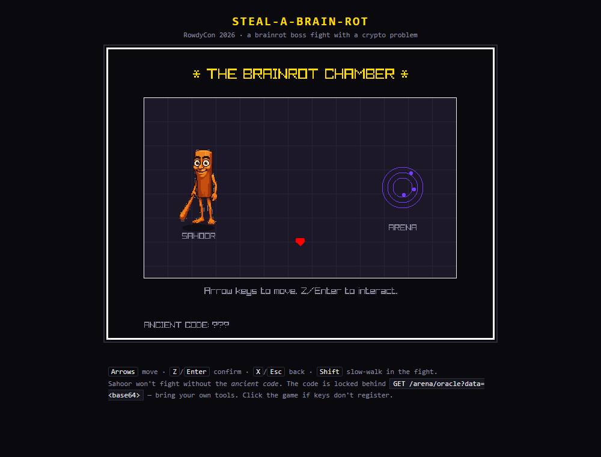
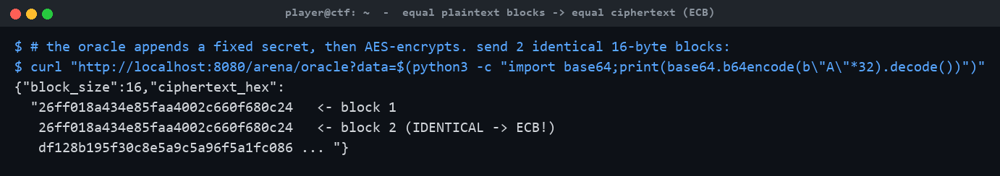
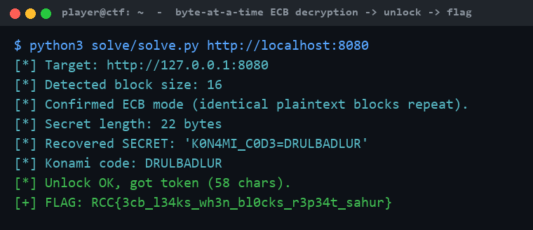

# Steal-a-Brain-Rot

**Category:** Crypto | **Difficulty:** Medium

## Description

**Tung Tung Tung Sahoor** has stolen everyone's attention span and he will NOT fight you until you prove you know "the ancient code." The code is sealed inside the Arena's humming oracle. Break the oracle, recover the code, enter it, and survive the brainrot bullet-hell to steal your brain back.



## Files

One hosted Docker container, built from [challenge/](challenge/). From that folder:

```sh
cd challenge
docker compose up --build -d      # then open http://localhost:8080
```

An Undertale-style browser game (C + raylib compiled to WebAssembly) wrapped around the crypto, served by a Flask backend that keeps the flag **server-authoritative** — it's emitted only by `/complete`, and only after a token that requires actually recovering the code from the oracle. The AES key is random per instance. Flag and a difficulty toggle (`ARENA_HINT_MODE`, default `0`) are set in [challenge/docker-compose.yml](challenge/docker-compose.yml); the oracle and gating are in [challenge/server/](challenge/server/). Reference solver (stdlib only) and writeups are in [organizer/](organizer/): `solve/solve.py`, `README.md`, `BRIEF.md`, `WRITEUP.md`, `API_CONTRACT.md`.

## Hint(s)

1. The Arena oracle appends a fixed secret to whatever you send, then encrypts. What mode is it in? Try sending two identical 16-byte blocks and look at the ciphertext.
2. It's AES-ECB. Equal plaintext blocks produce equal ciphertext blocks. You control a prefix — use it to line the unknown secret up against a block boundary.
3. Byte-at-a-time: send a prefix one byte short of a block so exactly one unknown byte sits at the end of a target block, then brute-force that byte against every `prefix + guess`. Shift by one and repeat. ("cryptopals challenge 12.")

## Walkthrough

A classic **AES-128-ECB byte-at-a-time decryption** attack (cryptopals #12). The game is a themed wrapper; the real gate is the oracle at `GET /arena/oracle?data=<base64>`, which returns `AES_ECB(your_bytes || SECRET)`.

1. **Talk to Sahoor.** He only spits memes and refuses to fight — `ANCIENT CODE: ???`. The overworld points you at the **Arena**, whose oracle encrypts `attacker_bytes || SECRET` under a fixed key.

2. **Confirm ECB.** Because ECB encrypts each 16-byte block independently, identical plaintext blocks map to identical ciphertext blocks. Send 32 bytes of `A` and the first two ciphertext blocks come back identical:



3. **Recover the secret byte-at-a-time.** Send a prefix one byte short of a block boundary so exactly one unknown secret byte lands at the end of a target block, then brute-force that byte by comparing against `prefix + guess` for all 256 values. Shift by one and repeat to peel off the whole secret: `K0N4MI_C0D3=DRULBADLUR`. The tail **DRULBADLUR** (Down Right Up Left B A Down Left Up Right) is the "ancient code" — deliberately *not* the famous Konami code, so you must break the oracle to learn it.

4. **Unlock and grab the flag.** Enter the recovered sequence in the game (or `POST /arena/unlock`) to get a signed token, then redeem it at `/complete` for the flag. The reference solver automates the full chain — oracle attack → unlock → complete — purely over HTTP:



## Flag

`RCC{3cb_l34ks_wh3n_bl0cks_r3p34t_sahur}`
