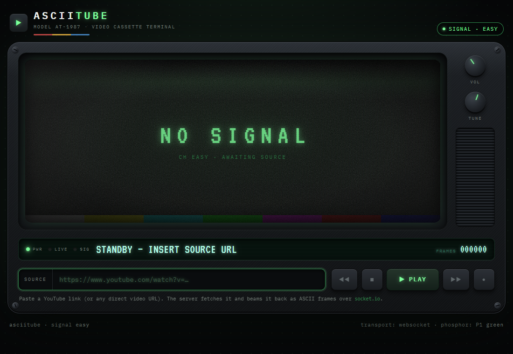
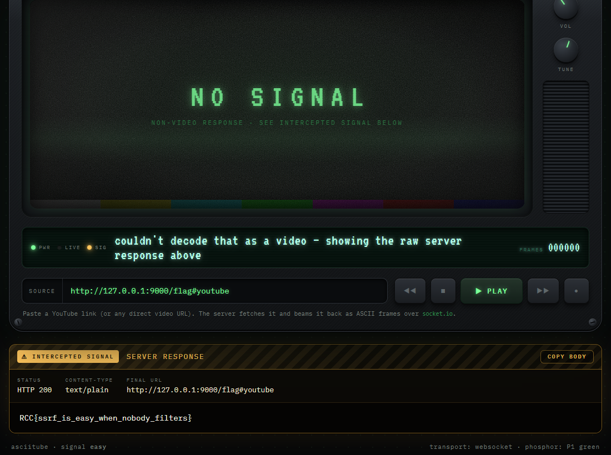

# asciitube: Now Playing

**Category:** Web | **Difficulty:** Easy

## Description

RowdyCon Systems just racked their coolest toy yet: **asciitube**, a Model AT-1987 "video cassette terminal" that takes any video link, fetches it, and beams it back to your browser as glorious phosphor-green ASCII.

The intern wired it up over the weekend and shipped it straight to production. "It just grabs whatever URL you paste and plays it — simple!" There's a little maintenance service humming away on the same box that was never meant to face the outside world, but hey, it's only listening on localhost. What could possibly go wrong?



## Files

One hosted Docker container, built from [challenge/](challenge/). From that folder:

```sh
cd challenge
docker compose up --build -d      # serves http://localhost:5001
```

The player is published on 5001; the internal flag service (`0.0.0.0:9000` inside the container) is never published — it's reachable only through the player's server-side fetch. The flag is set via `FLAG` in [challenge/docker-compose.yml](challenge/docker-compose.yml). Flask + Socket.IO app in [challenge/app.py](challenge/app.py). Reference solvers and writeups are in [organizer/](organizer/): `solve/solve_easy.py`, `README.md`, `solution.md`.

> Note: the build fetches a short YouTube clip for a gag ("caught" video). It's non-fatal if the build host has no network — the app fetches it once at runtime instead — and it has no bearing on the solve.

## Hint(s)

1. It's the *server* that fetches your link, not your browser — so it can reach things you can't, like a service listening on its own loopback interface.
2. Something is answering on a high port inside the box. Ask the terminal to "play" it, and watch what it shows you when the bytes it got back aren't actually a video.

## Walkthrough

A reflected **Server-Side Request Forgery (SSRF)**. asciitube fetches the "video" URL you submit *server-side*; if the bytes don't decode as a video, it reflects the raw response body back into the page. On easy there is **no host filtering** — the only check is a global anti-abuse gate requiring the URL string to contain the substring `youtube`.

1. **Spot the SSRF sink.** The terminal fetches whatever URL you paste, from its own network position. That reaches services bound to localhost inside the container that you can't hit directly. An internal metadata/flag service listens on `127.0.0.1:9000` and serves the flag at `/flag`.

2. **Satisfy the gate, aim at the internal service.** Point the player straight at the internal service and append a `#youtube` fragment:

   ```
   http://127.0.0.1:9000/flag#youtube
   ```

   - `#youtube` makes the string contain `youtube`, so the gate passes.
   - Fragments are never sent to the server, so the real request is `GET /flag`.
   - `/flag` returns `text/plain`, which doesn't decode as video — so the player reflects the body.

3. **Read the flag.** Paste the URL into SOURCE, press PLAY, and the amber "intercepted signal" panel shows the fetched response — the flag:



(The reference `solve/solve_easy.py` does the same over Socket.IO.)

## Flag

`RCC{ssrf_is_easy_when_nobody_filters}`
