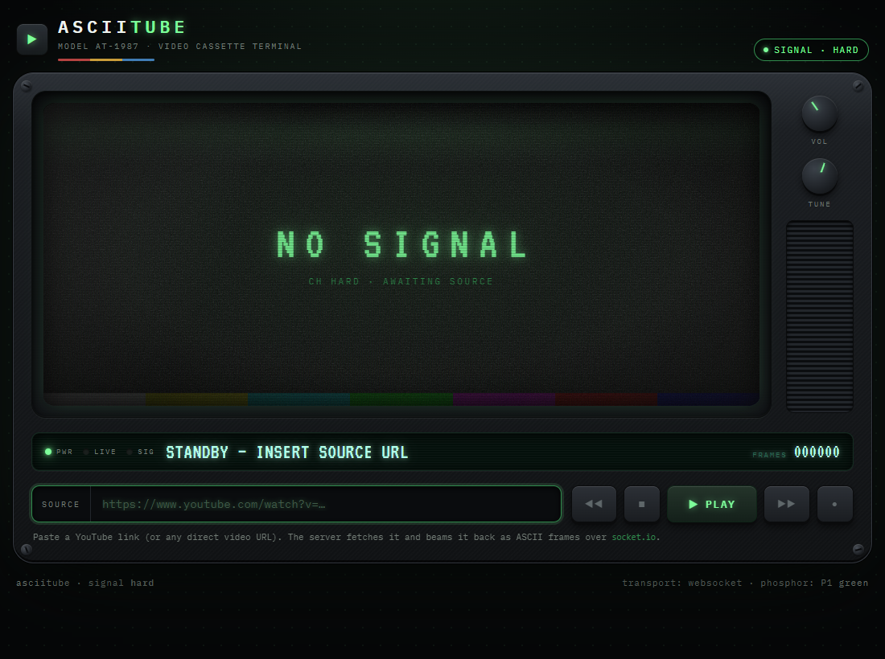
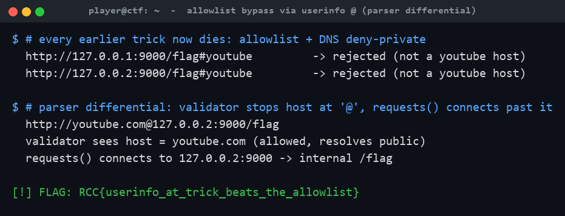
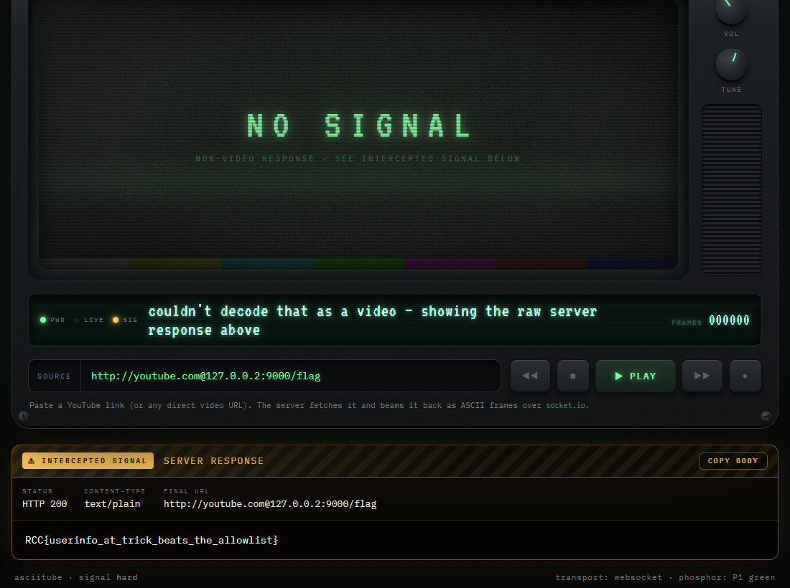

# asciitube: Scrambled Signal

**Category:** Web | **Difficulty:** Hard

## Description

Dave escalated. The terminal now accepts **only** real YouTube links: it pulls the host out of your URL, confirms it's YouTube, resolves the DNS, and rejects anything that lands on a private or loopback address. Every trick from the earlier channels is dead on arrival.

"Try getting to localhost *now*," Dave smirks.



## Files

One hosted Docker container, built from [challenge/](challenge/). From that folder:

```sh
cd challenge
docker compose up --build -d      # serves http://localhost:5003
```

Same app family as *Now Playing*, with stacked SSRF filters. The internal flag service (`0.0.0.0:9000` inside the container) is never published. The flag is set via `FLAG` in [challenge/docker-compose.yml](challenge/docker-compose.yml); the validation lives in [challenge/app.py](challenge/app.py). Reference exploit and writeups are in [organizer/](organizer/): `solve/solve_medium.py`, `solve/exploit.py`, `README.md`, `solution.md`.

## Hint(s)

1. Two different parts of the box read your URL — one decides whether it's *allowed*, the other actually goes and *fetches* it. They were written separately, and they don't always agree on where a link points.
2. Spend some time with how a URL's "authority" is really structured — the part between the `//` and the path. A hostname isn't the only thing permitted to live there.

## Walkthrough

A **parser differential**: the validator and the HTTP client disagree about where the URL points. The host is extracted with a hand-rolled regex that grabs the first run of host-ish characters after the scheme and **stops at `@`**, while `requests`/urllib3 parse per RFC 3986 (everything before `@` is *userinfo*; the real host is after it).

1. **See the stacked filters.** The URL must contain `youtube` (global gate); literal `localhost`/`127.0.0.1`/`0.0.0.0`/`::1`/`internal` are blocklisted; the extracted host must be a youtube domain (allowlist); and that host is resolved and rejected if it maps to a loopback/private/reserved address. Every earlier trick dies — a direct loopback URL is rejected as "not a youtube host":



2. **Split the validator from the client.** The host regex (`^\s*https?://([A-Za-z0-9.\-]+)`) stops at `@`. For `http://youtube.com@127.0.0.2:9000/flag` the validator reads the host as `youtube.com` (actually the userinfo), passes the allowlist, resolves *youtube.com* (public), and passes deny-private — but `requests` sends the request to `127.0.0.2:9000`. Use a non-literal loopback (`127.0.0.2`, not `127.0.0.1`) so the substring blocklist doesn't fire, and keep a youtube domain in the userinfo to satisfy the gate and allowlist:

   ```
   http://youtube.com@127.0.0.2:9000/flag
   ```

3. **Read the flag.** The client connects to the internal service, which returns `text/plain`, so the player reflects the body:



> Why deny-private doesn't save it: the check resolves the *validator's* idea of the host (`youtube.com`), never the address the request actually reaches. Validation and connection must operate on the **same** parsed host, or an attacker splits them. (Other post-`@` encodings like `@127.1` or `@2130706433` work too.)

## Flag

`RCC{userinfo_at_trick_beats_the_allowlist}`
